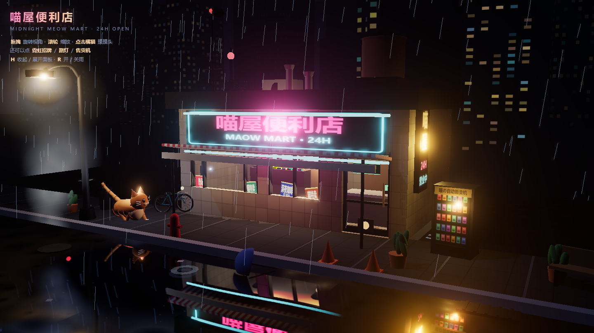
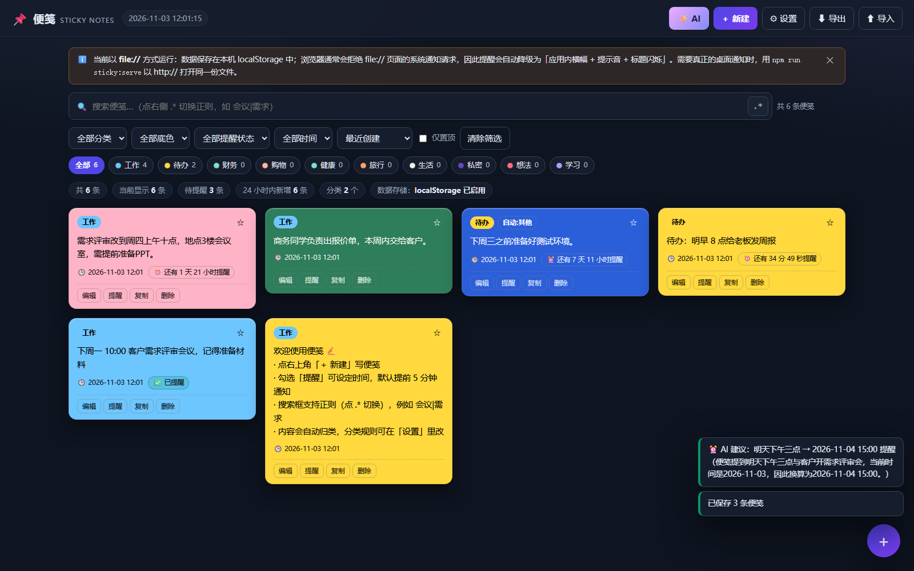

# 🐱 喵屋便利店 · Midnight Meow Mart

一个完全用 **Three.js 程序化生成**的雨夜 3D 小镇：霓虹灯便利店、会走路的橘猫、积水倒影、斜飞的雨丝、远景城市天际线。

**没有任何外部模型 / 贴图文件** —— 建筑、猫、自行车、售货机、招牌文字、瓷砖、路面全部是用代码在运行时"长"出来的（Canvas 贴图 + 基础几何体）。



---

## 快速开始

```bash
npm install
npm run dev        # http://127.0.0.1:5173
```

生产构建：

```bash
npm run build      # 输出到 dist/
npm run preview    # 本地预览构建结果
```

## 玩法

| 操作 | 效果 |
| --- | --- |
| 拖拽 | 旋转视角 |
| 滚轮 | 推拉镜头 |
| 点击橘猫 | 摸摸头 → 猫会开心地跳起来并冒爱心（同时弹出"喵～！"） |
| 点击霓虹招牌 | 开关招牌（关掉时会有接触不良的抽搐效果） |
| 点击路灯 | 开关路灯 |
| 点击售货机 | 哐当！掉出一罐猫罐头 |
| `H` | 收起 / 展开左上角面板 |
| `R` | 开关雨 |

闲置 9 秒后镜头会自动缓慢环绕，像拍橱窗广告一样。

---

## 场景里有什么

### 🏪 喵屋便利店（`src/world/store.js`）
- 立面用 `ExtrudeGeometry` + `Shape.holes` 挖出 **两扇橱窗 + 一扇门洞**，比拼盒子更有建筑感
- 门是独立铰链组，开合时会轻轻晃动；门上还有猫洞
- 招牌是 Canvas 画的霓虹字：**粉色店名 + 青色副标题 + 霓虹管边框**，同一张画布同时产出 `map` 和 `emissiveMap`
- 侧面竖招牌（刀旗）：喵 / 屋 / 24H / 营业中
- 屋内有货架、冷柜、收银台、咖啡机、吊灯和柜台绿植，商品用 `InstancedMesh` 随机上色
- 屋顶：空调外机（风扇会转）、水塔、通风管、天线、闪烁的航空警示灯

### 🐈 橘猫（`src/world/cat.js`）
- 纯几何体拼装：球体身体 + 圆锥耳朵 + 眼球 + 鼻头 + `LineSegments` 胡须 + 6 节链式尾巴 + 虎斑半环 + 红项圈铃铛
- 有限状态机：**走路 / 坐下 / 发呆 / 被摸头**
- 走路时四肢按对角步态摆动、身体上下起伏、尾巴左右摆；坐姿会压低后半身、收起后腿
- 会眨眼、耳朵随情绪抖动、随机转头张望
- 被点击时：跳一下、竖起耳朵、冒出上浮的爱心粒子

### 🌧️ 雨夜街景
- **天空**：自定义 Shader 天穹（顶部深蓝 → 地平线城市光污染暖光），1400 颗闪烁的星星、带光晕的月亮、薄云
- **远景**：程序化楼群剪影 + 随机亮着的窗户 + 红色航空警示灯
- **雨水**：`LineSegments` 雨丝（1500 条，带风偏斜）+ 地面随机扩散的涟漪
- **水洼**：路面材质带 `alphaMap`，水洼中心镂空露出下方的 `Reflector` 镜面，并给镜面 shader 加了水波扰动，倒影会轻轻晃动
- **道具**：路灯（带柔光光晕）、自动售货机、自行车、长椅、垃圾桶、交通锥、消防栓、盆栽、电线杆 + 垂落的电线 + 停在电线上的鸟、井盖冒出的蒸汽、绕着路灯飞的飞蛾

### 🎬 渲染与后处理
- `WebGLRenderer` + ACES Filmic 色调映射
- `EffectComposer`：`RenderPass` → `UnrealBloomPass`（霓虹辉光）→ `OutputPass`
- 阴影：平行光（月光）PCF 阴影 + 路灯点光源的立方体阴影
- IBL：用一张手绘渐变天空经 `PMREMGenerator` 生成环境贴图，让玻璃和金属有夜色的反光
- `RectAreaLight` 模拟橱窗洒到人行道上的暖光

---

## 目录结构

```
src/
├─ main.js              渲染器 / 相机 / 后处理 / 交互 / 主循环
├─ style.css            HUD 与加载动画
├─ util/
│  ├─ rng.js            线性同余伪随机（保证每次生成的场景一致）
│  ├─ textures.js       Canvas 贴图工厂（沥青 / 瓷砖 / 霓虹 / 海报 / 售货机…）
│  └─ puddle.js         水洼遮罩
└─ world/
   ├─ sky.js            天穹 / 星空 / 月亮 / 云
   ├─ skyline.js        远景楼群
   ├─ street.js         路面 / 人行道 / 水洼镜面
   ├─ store.js          便利店建筑与店内陈设
   ├─ cat.js            橘猫模型与行为
   ├─ props.js          街道道具
   └─ rain.js           雨丝与涟漪
```

## 性能

- 全场约 300 个几何体 / 50 张贴图，每帧约 800 个 draw call（其中一半来自水洼镜面的第二次渲染）
- 远景楼群用 `mergeGeometries` 合并成 2 个 Mesh，商品用 `InstancedMesh`
- 路灯点光源**不投影**（立方体阴影要渲 6 遍，代价太大），只保留月光平行光的阴影
- 内置自适应画质：检测到帧率低于 24fps 时会自动关闭水洼反射与阴影（软件渲染器不触发）

## 技术要点

1. **水洼反射**：镜面放在 `y=0.008`，路面平面放在 `y=0.03` 并用 `alphaMap` 把水洼区域"挖空"，于是水洼处直接看到镜子，边缘平滑过渡回沥青。
2. **霓虹字**：Canvas 同时绘制彩色版与纯发光版两张贴图，配合 `emissiveIntensity` + Bloom，得到接近真实霓虹管的观感。
3. **透视立面**：`Shape` + `Path` 洞 → `ExtrudeGeometry`，一次性得到带真实窗洞的墙体，玻璃再单独贴上去。
4. **性能**：商品用 `InstancedMesh`，雨丝共用一个 `BufferGeometry`，全场约 100 个 draw call 量级。

## License

MIT

---

## 🐍 附：贪吃蛇竞赛（另一个页面）

同一仓库里还有一款独立的小游戏 **贪吃蛇竞赛 / Snake Arena**（`snake-race/`），2–4 条 AI 蛇同场围杀，**生存到最后的蛇获胜**：

- 标准贪吃蛇规则（不可掉头、吃食变长、撞墙/撞身体/头对头判负、尾巴让位）
- 1 条「随机避障」基准蛇 + 4 种自研算法（空间安全 / 猎手封锁 / 围堵切尾 / 谨慎拉扯）
- **每轮计算硬性 ≤ 50ms**：单蛇 10ms 预算 + 整轮软截止，HUD 实时显示耗时
- 无头自测（规则断言 + 压测）与基准（胜率 / 局长 / 耗时）

```bash
npm run dev   # http://127.0.0.1:5173/snake-race/index.html
node snake-race/tools/selftest.mjs
node snake-race/tools/bench.mjs 60 3000 4
```

细节见 [`snake-race/README.md`](snake-race/README.md)。
---

## 🎬 短片《60 秒看懂 Self-Attention → Transformer》

同一仓库里还有一支 **60 秒的图解短片**（`attention-film/`）：用 Canvas 2D 把「Self-Attention 是什么、Transformer 怎么把它组装起来」讲清楚。

- 🎥 成片：[`attention-film/release/attention-film.mp4`](attention-film/release/attention-film.mp4) — 1920×1080 / 30fps / 60.0s / H.264+AAC / 6.2MB
- 🖼️ 封面：[`attention-film/release/poster.jpg`](attention-film/release/poster.jpg)
- ▶️ 网页版（可拖进度）：`npm run dev` → <http://127.0.0.1:5173/attention-film/>

内容：8 个章节 60 秒 —— 词向量长出 Q/K/V → q·k 打分与 softmax → 注意力矩阵热力图 → 多头注意力 → Transformer Block（残差 + LayerNorm + FFN，堆 6 层）→ Encoder/Decoder 全景 → 一行公式收尾，每章带同步字幕。

技术要点：**每一帧都是时间 `t` 的纯函数**（`renderFrame(ctx, t)`），所以进度条可以任意拖、无头渲染能逐帧精确复现；再由 Puppeteer 逐帧截图 + ffmpeg 合成 MP4，背景音乐也是 WebAudio 离线程序化生成的。

```bash
npm run film:build      # build → 生成音乐 → 逐帧渲染 1800 帧 → ffmpeg 合成 MP4
npm run film:layout     # 排版体检：自动报出文字重叠 / 出界
```

细节见 [`attention-film/README.md`](attention-film/README.md)。

---

## 📺 附：IPTV 剧场（在线直播播放器）

同一仓库里还有一个 **网页版 IPTV 播放器**（`iptv-player/`）：聚合 GitHub 上的公开直播源（M3U 列表），**在线频道自动更新**。

- 📡 **87 个内置源**：iptv-org 的国家 / 分类 / 语言 / 大区列表 + Free-TV 社区清单，全部带 CORS 头，浏览器可直连
- 🔄 **自动更新**：定时（默认 30 分钟）+ 启动 + 切回前台；**ETag 条件请求 + 内容哈希**判重，无变化时零流量；更新后提示「新增 / 移除」频道数
- 🐙 **GitHub 提交检测**：源管理器里直接查该源所在仓库的最新提交
- ▶️ **播放**：hls.js（MSE）/ Safari 原生 HLS / 直链，自动错误恢复、备用线路切换、清晰度选择
- 🧪 **本地流代理**：直播服务器大多不带 CORS 头，仓库内置 `/api/proxy` 同源转发（自动跟 302、改写清单相对 URI、带 ETag 缓存）
- 🔍 **频道体检**：批量并发探测，绿=可播 / 黄=可达 / 红=失效，可一键隐藏失效频道
- ⭐ 收藏 / 最近观看 / 搜索 / 分类 / 国家筛选 / 可选 XMLTV 节目单，全量持久化

```bash
npm run dev              # http://127.0.0.1:5173/iptv-player/index.html
npm run iptv:serve       # 独立服务器跑 dist 产物（带流代理）：http://127.0.0.1:5180/
npm run iptv:single       # 生成单文件版，双击 iptv-player/dist-single/iptv-player.html 即可用
node iptv-player/tools/selftest.mjs            # 47 项离线断言
node iptv-player/tools/shot.mjs                # 无头浏览器跑完整流程 + 截图
```

细节见 [`iptv-player/README.md`](iptv-player/README.md)。

---

## 📌 附：便笺（Sticky Notes）

同一仓库里还有一个**纯前端、纯本地**的便笺应用 —— 双击 `sticky-notes/index.html` 就能用，不联网、不上传、数据存在本机 localStorage；可选接上本机 tea_a2（`http://localhost:8383`）做 AI 增强。



- 🎨 **彩色便笺 + 高对比度**：12 种底色，文字色自动按 WCAG 对比度挑选（全部 ≥ 4.5:1，编辑器实时显示对比度与 AAA/AA 徽章）
- ⏰ **自动记时 + 提前 5 分钟提醒**：新建即记录创建时间；勾选提醒后按「指定时间 − 5 分钟」触发，同时申请浏览器通知权限；file:// 下浏览器拒绝通知时自动降级为应用内横幅 + 提示音 + 标题闪烁
- 🗂️ **自动归类 + 正则查询**：10 条可编辑的正则分类规则（命中数优先、优先级兜底、私密类 sticky 锁定）；搜索框一键切正则，命中处高亮，非法正则只报错不崩溃
- ✨ **AI 增强**（默认关闭）：接本机 tea_a2 的 `/api/llm/chat` —— AI 归类、AI 从便笺里抽时间并设成提醒、基于本机便笺的问答、长文拆条、联网整理（`web_tools`）；内置 `reasoning_effort` 阶梯降级（none → minimal → low → 不传），避免模型把预算全花在思考上导致正文为空

```bash
npm run test:sticky       # 81 项离线断言（Node 直跑）
npm run sticky:verify     # 无头 Edge 端到端验证 44 项 + 截图（file:// 真实场景，含 AI）
npm run sticky:ai         # AI 接口联调 17 项（打真实 tea_a2）
npm run sticky:build      # 打包单文件版 sticky-notes/sticky-notes.html
npm run sticky:serve      # http://127.0.0.1:5177/（此模式才有真正的桌面通知）
```

细节见 [`sticky-notes/README.md`](sticky-notes/README.md)。
---

## 🏘️ AI 小镇：无限人生（`ai-town/`）

同一仓库里还有一款 **由 LLM 实时生成一切的文字模拟经营游戏**（Python + Tkinter）：你是新上任的镇长，居民、每日事件、主线剧情、危机全部由 LLM 现场生成，**没有两次相同的存档**。

- 🧠 **LLM 只出素材，数值由状态机落地**：LLM 只能从固定词表里挑语义标签（`kind` / `costly` / `build:market` / `trust:n_3`），由确定性规则系统换算成金币、民心、信任 —— 有随机性，但数值不会崩
- 🧑‍🤝‍🧑 **涌现式 NPC**：姓名、性格、背景、秘密、彼此的关系网（谁暗恋谁、谁欠谁的债）由模型现场编造，关系网由程序补全
- 🕯️ **记忆驱动**：你做过的每件事都进记忆，模型之后会拿旧事来「翻旧账」
- 🧠 **17 种结局**：按民心、信任、财富与行为倾向判定
- 🔌 **在线 MiniMax（MiniMax-M3.1-Flash）/ 本地 Ollama / 任意 OpenAI 兼容端点 / 完全离线**（离线时由程序化叙述器接管，照样可玩）

```bash
cd ai-town
python main.py                 # 启动图形界面
python main.py --offline       # 不联网的离线版
python main.py --sim --days 20 # 无头模拟，打印 20 天流水账
python main.py --autoplay --days 30   # 全 NPC 自动玩：AI 当镇长，世界自己跑
python main.py --selftest      # 单元测试
python main.py --doctor        # 检查 LLM 连通性
```

细节见 [`ai-town/README.md`](ai-town/README.md)。
