<div align="center">

# 🎪 a2_demo · 多项目实验场

**18 个各自独立、打开就能跑的小项目**
3D 场景 · 纯前端小应用 · LLM 玩法 · 内容抓取 · 素材与建模

`npm install` → `npm run dev` → <http://127.0.0.1:5173/>

<sub>本仓库项目皆由 [tea_a2](https://github.com/sunkwei/tea_a2) 创建 · 更细的索引见 [`docs/INDEX.md`](docs/INDEX.md)</sub>

</div>

---

## 🖼️ 项目横幅

> 点横幅直接进项目；「说明」是该项目的 README。命令行 / 编辑器项目没有网页入口，横幅会指向说明。
> 需要按技术栈、启动方式横向对比，看下面的 **📇 速查表**。

<table>
<tr>
<td width="50%" valign="top">
  <a href="meow-mart/index.html">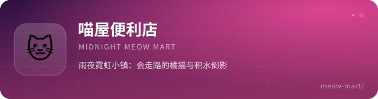</a>
  <p><b>🐱 喵屋便利店</b> · Midnight Meow Mart<br>
  <sub>雨夜霓虹小镇：会走路的橘猫与积水倒影 · Three.js + Vite<br>
  <code>meow-mart/</code> · <code>npm run dev</code> · <a href="meow-mart/README.md">说明</a></sub></p>
</td>
<td width="50%" valign="top">
  <a href="endfield-ship/index.html">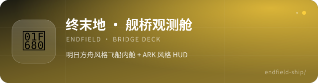</a>
  <p><b>🚀 终末地 · 舰桥观测舱</b> · Endfield Bridge Deck<br>
  <sub>明日方舟风格飞船内舱 + ARK 风格 HUD · Three.js + 原生 ESM<br>
  <code>endfield-ship/</code> · <code>npm run dev</code> · <a href="endfield-ship/README.md">说明</a></sub></p>
</td>
</tr>
<tr>
<td width="50%" valign="top">
  <a href="snake-race/index.html">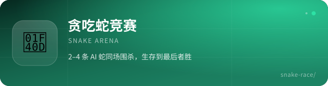</a>
  <p><b>🐍 贪吃蛇竞赛</b> · Snake Arena<br>
  <sub>2–4 条 AI 蛇同场围杀，5 种避让算法竞技 · 原生 JS + Canvas<br>
  <code>snake-race/</code> · <code>npm run dev</code> · <a href="snake-race/README.md">说明</a></sub></p>
</td>
<td width="50%" valign="top">
  <a href="attention-film/index.html">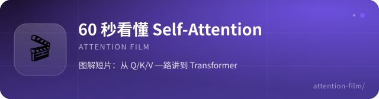</a>
  <p><b>🎬 60 秒看懂 Self-Attention</b> · Attention Film<br>
  <sub>图解短片：从 Q/K/V 一路讲到 Transformer · Canvas 2D + ffmpeg<br>
  <code>attention-film/</code> · <code>npm run dev</code> · <a href="attention-film/README.md">说明</a></sub></p>
</td>
</tr>
<tr>
<td width="50%" valign="top">
  <a href="iptv-player/index.html"></a>
  <p><b>📺 IPTV 剧场</b> · IPTV Theater<br>
  <sub>87 个内置直播源、在线更新、同源流代理、频道体检 · hls.js<br>
  <code>iptv-player/</code> · <code>npm run dev</code> · <a href="iptv-player/README.md">说明</a></sub></p>
</td>
<td width="50%" valign="top">
  <a href="sticky-notes/index.html">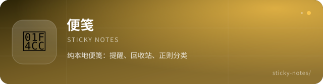</a>
  <p><b>📌 便笺</b> · Sticky Notes<br>
  <sub>纯本地便笺：提醒、回收站、正则分类、可选 AI · 原生 JS（file://）<br>
  <code>sticky-notes/</code> · 双击 <code>index.html</code> · <a href="sticky-notes/README.md">说明</a></sub></p>
</td>
</tr>
<tr>
<td width="50%" valign="top">
  <a href="rubiks-cube/index.html">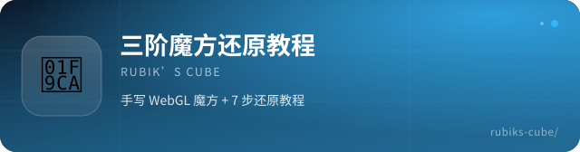</a>
  <p><b>🧊 三阶魔方还原教程</b> · Rubik’s Cube<br>
  <sub>手写 WebGL 魔方 + 鼠标拧层 + 7 步还原教程 · 零依赖（file://）<br>
  <code>rubiks-cube/</code> · 双击 <code>index.html</code> · <a href="rubiks-cube/README.md">说明</a></sub></p>
</td>
<td width="50%" valign="top">
  <a href="tcm-herb/index.html">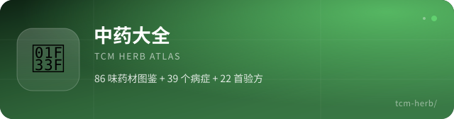</a>
  <p><b>🌿 中药大全</b> · TCM Herb Atlas<br>
  <sub>86 味药材图鉴 + 39 个病症 + 22 首验方，离线可用 · 原生 JS<br>
  <code>tcm-herb/</code> · 双击 <code>index.html</code> · <a href="tcm-herb/README.md">说明</a></sub></p>
</td>
</tr>
<tr>
<td width="50%" valign="top">
  <a href="pottery/index.html">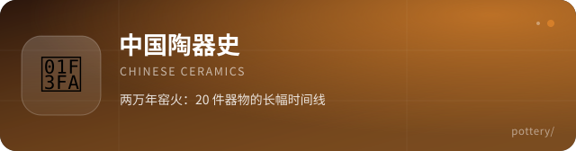</a>
  <p><b>🏺 中国陶器史</b> · Chinese Ceramics<br>
  <sub>两万年窑火：20 件器物的长幅时间线 + Web Audio 配乐 + AI 问答<br>
  <code>pottery/</code> · 双击 <code>index.html</code> · <a href="pottery/README.md">说明</a></sub></p>
</td>
<td width="50%" valign="top">
  <a href="ai-town/README.md">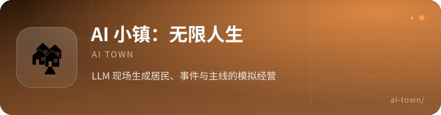</a>
  <p><b>🏘️ AI 小镇：无限人生</b> · AI Town<br>
  <sub>LLM 现场生成居民、事件与主线的模拟经营 · Python + Tkinter<br>
  <code>ai-town/</code> · <code>python ai-town/main.py</code> · <a href="ai-town/README.md">说明</a></sub></p>
</td>
</tr>
<tr>
<td width="50%" valign="top">
  <a href="li-qingzhao/index.html">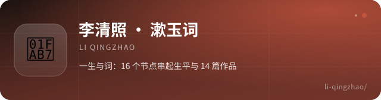</a>
  <p><b>🪷 李清照 · 漱玉词</b> · Li Qingzhao<br>
  <sub>一生与词：16 个节点串起生平与 14 篇作品 + 真实古琴《阳关三叠》背景音乐 · 原生 JS（file://）<br>
  <code>li-qingzhao/</code> · 双击 <code>index.html</code> · <a href="li-qingzhao/README.md">说明</a></sub></p>
</td>
<td width="50%" valign="top">
  <a href="piano/index.html">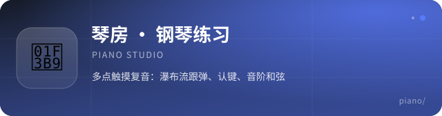</a>
  <p><b>🎹 琴房</b> · Piano Studio<br>
  <sub>多点触摸钢琴：十指同时按下即复音，瀑布流跟弹 / 认键 / 音阶和弦 + 加法合成音色 · 原生 JS（file://）<br>
  <code>piano/</code> · 双击 <code>index.html</code> · <a href="piano/README.md">说明</a></sub></p>
</td>
</tr>
<tr>
<td colspan="2" width="100%" valign="top">
  <a href="firefox-tab-colors/README.md">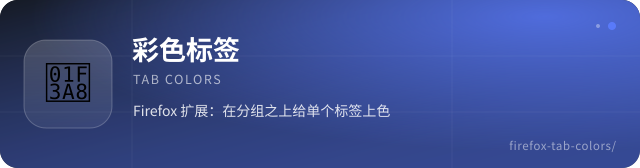</a>
  <p><b>🎨 彩色标签</b> · Tab Colors（Firefox 扩展）<br>
  <sub>在原生标签分组之上给单个标签上色：彩色图标 + 强制标题前缀，9 色 / 整组染色 / 右键菜单 · MV3<br>
  <code>firefox-tab-colors/</code> · <code>about:debugging</code> 临时加载 · <a href="firefox-tab-colors/README.md">说明</a></sub></p>
</td>
</tr>
<tr>
<td width="50%" valign="top">
  <a href="sanguosha-ai/web/index.html">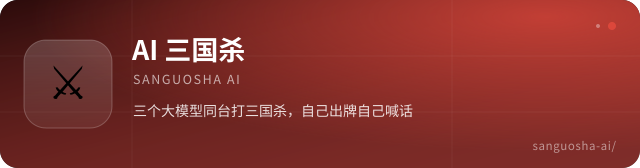</a>
  <p><b>⚔️ AI 三国杀</b> · Sanguosha AI<br>
  <sub>三个大模型同台打三国杀，自己出牌自己喊话 · Python + HTML5<br>
  <code>sanguosha-ai/</code> · <code>npm run sgss:web</code> · <a href="sanguosha-ai/README.md">说明</a></sub></p>
</td>
<td width="50%" valign="top">
  <a href="tea-select/README.md">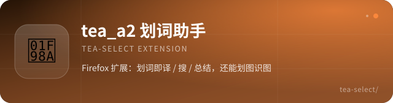</a>
  <p><b>🦊 tea_a2 划词助手</b> · tea-select Extension<br>
  <sub>Firefox 扩展：划词即译 / 搜 / 总结，还能划图识图 · JS (MV3)<br>
  <code>tea-select/</code> · <code>web-ext run</code> · <a href="tea-select/README.md">说明</a></sub></p>
</td>
</tr>
<tr>
<td width="50%" valign="top">
  <a href="bilibili/README.md">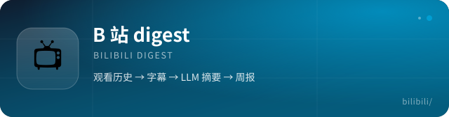</a>
  <p><b>📺 B 站 digest</b> · Bilibili Digest<br>
  <sub>观看历史 → 字幕 → LLM 摘要 → 周报；还能 discover 值得收藏的 · Python<br>
  <code>bilibili/</code> · <code>python bilibili/bili.py all</code> · <a href="bilibili/README.md">说明</a></sub></p>
</td>
<td width="50%" valign="top">
  <a href="zhihu/README.md">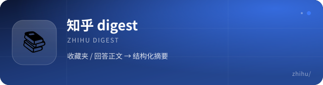</a>
  <p><b>📚 知乎 digest</b> · Zhihu Digest<br>
  <sub>收藏夹 / 回答正文 → 结构化摘要；也能读完再写一篇 · Python<br>
  <code>zhihu/</code> · <code>python zhihu/zhihu.py digest</code> · <a href="zhihu/README.md">说明</a></sub></p>
</td>
</tr>
<tr>
<td width="50%" valign="top">
  <a href="video_analysis/README.md">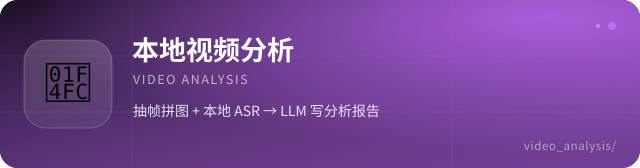</a>
  <p><b>📼 本地视频分析</b> · Video Analysis<br>
  <sub>抽帧拼图 + 本地 ASR（SenseVoice）→ LLM 写分析报告 · Python + ONNX<br>
  <code>video_analysis/</code> · <code>python video_analysis/video_analysis.py &lt;视频&gt;</code> · <a href="video_analysis/README.md">说明</a></sub></p>
</td>
<td width="50%" valign="top">
  <a href="GoDot/README.md"></a>
  <p><b>🎮 GoDot · 三国肉鸽</b> · Godot Roguelike<br>
  <sub>Godot 4 项目：三国题材肉鸽 · GDScript<br>
  <code>GoDot/</code> · Godot 打开 <code>project.godot</code> · <a href="GoDot/README.md">说明</a></sub></p>
</td>
</tr>
<tr>
<td width="50%" valign="top">
  <a href="zhanqiao/README.md">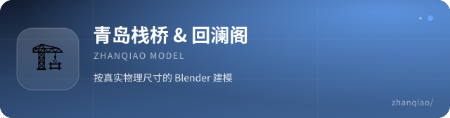</a>
  <p><b>🏗️ 青岛栈桥 &amp; 回澜阁</b> · Zhanqiao Model<br>
  <sub>按真实物理尺寸的 Blender 建模 + 尺寸校验脚本 · Blender + Python<br>
  <code>zhanqiao/</code> · 打开 <code>.blend</code> · <a href="zhanqiao/README.md">说明</a></sub></p>
</td>
<td width="50%" valign="top">
  <p align="center"><sub>🗂️ 横幅由 <code>tools/gen-project-index.mjs</code> 生成<br>
  改文案后重跑一次，横幅与根目录索引页一起更新</sub></p>
</td>
</tr>
</table>

---

## 📇 速查表

| # | 项目 | 目录 | 一句话定位 | 技术栈 | 启动 | 自测 |
|---|------|------|-----------|--------|------|------|
| 1 | 🐱 喵屋便利店 | `meow-mart/` | 雨夜 3D 小镇：霓虹便利店、橘猫、积水倒影 | Three.js + Vite | `npm run dev` → `/meow-mart/` | — |
| 2 | 🚀 终末地 · 舰桥观测舱 | `endfield-ship/` | 明日方舟风格飞船内舱 + ARK 风格 HUD | Three.js + 原生 ESM | `npm run dev` | `npm run test:endfield` |
| 3 | 🐍 贪吃蛇竞赛 | `snake-race/` | 2–4 条 AI 蛇同场围杀，5 种避让算法 | 原生 JS + Canvas | `npm run dev` | `npm run test:snake` |
| 4 | 🎬 Self-Attention 短片 | `attention-film/` | 60 秒图解 Transformer | Canvas 2D + ffmpeg | `npm run dev` | `npm run film:layout` |
| 5 | 📺 IPTV 剧场 | `iptv-player/` | 87 个源的网页直播播放器 | 原生 JS + hls.js | `npm run dev` | `npm run test:iptv` |
| 6 | 📌 便笺 | `sticky-notes/` | 纯本地便笺：提醒 / 回收站 / 正则分类 | 原生 JS（file://） | 双击 `index.html` | `npm run test:sticky` |
| 7 | 🧊 三阶魔方教程 | `rubiks-cube/` | 手写 WebGL 魔方 + 7 步还原教程 | WebGL（零依赖） | 双击 `index.html` | `npm run test:rubik` |
| 8 | 🌿 中药大全 | `tcm-herb/` | 86 味药材 / 39 病症 / 22 验方 | 原生 JS（file://） | 双击 `index.html` | `npm run test:tcm` |
| 9 | 🏺 中国陶器史 | `pottery/` | 两万年长幅时间线 + 实时合成配乐 | 原生 JS（file://） | 双击 `index.html` | `npm run test:pottery` |
| 10 | 🪷 李清照 · 漱玉词 | `li-qingzhao/` | 一生与词：16 个节点 + 真实古琴配乐 | 原生 JS（file://） | 双击 `index.html` | `npm run test:lqz` |
| 11 | 🎹 琴房 | `piano/` | 多点触摸钢琴：复音 / 瀑布流跟弹 / 认键 / 音阶和弦 | 原生 JS（file://） | 双击 `index.html` | `npm run test:piano` |
| 12 | 🏘️ AI 小镇 | `ai-town/` | LLM 实时生成一切文字的模拟经营 | Python + Tkinter | `python ai-town/main.py` | `python ai-town/main.py --selftest` |
| 13 | ⚔️ AI 三国杀 | `sanguosha-ai/` | 三个大模型同台打三国杀 | Python + HTML5 | `npm run sgss:web` | `npm run test:sgss` |
| 14 | 🦊 tea_a2 划词助手 | `tea-select/` | 划词即译 / 搜 / 总结 + 划图识图 | JS (MV3) | `web-ext run` | `node tea-select/tools/selftest.mjs` |
| 15 | 📺 B 站 digest | `bilibili/` | 观看历史 → 字幕 → LLM 周报 | Python | `python bilibili/bili.py all` | — |
| 16 | 📚 知乎 digest | `zhihu/` | 收藏夹 / 回答正文 → 摘要 | Python | `python zhihu/zhihu.py digest` | `python zhihu/tests/test_zhihu_llm_post.py` |
| 17 | 📼 本地视频分析 | `video_analysis/` | 抽帧拼图 + 本地 ASR → 分析报告 | Python + ONNX | `python video_analysis/video_analysis.py <视频>` | — |
| 18 | 🎮 GoDot 三国肉鸽 | `GoDot/` | Godot 4 项目：三国题材肉鸽 | Godot 4 | Godot 打开 | — |
| 19 | 🏗️ 青岛栈桥建模 | `zhanqiao/` | 真实尺寸 Blender 建模 | Blender | 打开 `.blend` | `python zhanqiao/verify.py` |
| 20 | 🎨 彩色标签 | `firefox-tab-colors/` | Firefox 扩展：单个标签上色（分组之上再区分） | WebExtension MV3 | `about:debugging` 临时加载 | `npm run tabcolors:e2e -- <端口>` |

> `shared/` 不是独立项目：它是 `bilibili/` 与 `zhihu/` 共用的登录态 + LLM 调用层。
> 五个 LLM 相关应用（便笺 / 划词助手 / 三国杀 / 陶器史 / 李清照）默认连本机 `tea_a2`（`http://localhost:8383`）。

---

## 🧾 用户输入（原始需求）

凡是**本机创建**的项目，目录下除了 `README.md`，还有一份 **`PROMPT.md`**：它当初是怎么被要求做出来的、后来又改了什么，
按时间列出**用户输入原文**——已剔除「继续」「嗯」「提交,推送」这类没有信息量的指令、纯夸奖句，以及工具回填的系统消息。

| 情况 | 项目 | `PROMPT.md` |
|------|------|-------------|
| ✅ 本机创建 + 有留档 | 🦊 `tea-select/`、🏺 `pottery/`、🪷 `li-qingzhao/` | 创建与后续改动都在 |
| ⚠️ 本机创建，但会话没留下 | 🌿 中药大全、📌 便笺、🧊 魔方、🚀 终末地、🏘️ AI 小镇、⚔️ 三国杀、📼 视频分析、🏗️ 栈桥 | 无（可补录） |
| 📦 **外部引入**（不是本机创建的） | 📺 `bilibili/`、📚 `zhihu/`、🐱 `meow-mart/`、🐍 贪吃蛇、🎬 短片、📺 IPTV、🎮 GoDot | 本机没有创建提示词；`bilibili/`、`meow-mart/` 有一份，但只含搬进来之后的改动 |

外部引入的项目随早期提交搬进仓库（`feat: 提交 demo 全部代码` / `…搬进这个仓库`），创建过程不在这台机器上，
所以**不承诺**有原始提示词；本机创建但会话没留下的那几个，补录办法见 [`docs/PROMPTS.md`](docs/PROMPTS.md)。

收录条数、仓库级输入与过滤规则都在 [`docs/PROMPTS.md`](docs/PROMPTS.md)；
重新生成：`npm run prompts:build`（扫描 `.tea_agent_run/sessions/`，过滤后按项目写回 `PROMPT.md`）。

---

## 🚀 快速开始

```bash
npm install
npm run dev        # http://127.0.0.1:5173/  ← 项目索引页
```

| 想看的页面 | 地址 |
|-----------|------|
| 项目索引（落地页） | <http://127.0.0.1:5173/> |
| 🐱 喵屋便利店 | <http://127.0.0.1:5173/meow-mart/> |
| 🚀 终末地 · 舰桥观测舱 | <http://127.0.0.1:5173/endfield-ship/> |
| 🐍 贪吃蛇竞赛 | <http://127.0.0.1:5173/snake-race/> |
| 🎬 Self-Attention 短片 | <http://127.0.0.1:5173/attention-film/> |
| 📺 IPTV 剧场 | <http://127.0.0.1:5173/iptv-player/> |
| 📌 便笺 / 🧊 魔方 / 🌿 中药 / 🏺 陶器 / 🪷 李清照 | 双击各自目录下的 `index.html`（file:// 直开） |

生产构建：

```bash
npm run build      # 输出到 dist/（索引页 + 上面几个 Vite 页面）
npm run preview    # 本地预览构建结果
```

### 三类项目，三种跑法

1. **Vite 工程托管**（共用一个 `vite.config.js`）：索引页、喵屋便利店、终末地、贪吃蛇、短片、IPTV、三国杀网页版。
2. **纯 `file://` 应用**：便笺、魔方、中药大全、陶器史、李清照 —— 用经典 `<script>` 引入，双击 `index.html` 即可（ES module 在 `file://` 下会被 CORS 拦）。
3. **命令行 / 编辑器项目**：AI 小镇、B 站 / 知乎 digest、视频分析、tea-select 扩展、Godot 工程、Blender 建模 —— 看各自 README。

> Python 脚本请用系统解释器 `/usr/bin/python3`（带有 requests / pyyaml / playwright）。

---

## 🔗 依赖关系

```
                    ┌──────────────────────────────────────────┐
  根 Vite 工程 ────▶│ 索引页 /  meow-mart/  endfield-ship/      │
  (vite.config.js)  │ snake-race/  attention-film/  iptv-player/│
                    └──────────────────────────────────────────┘

   shared/  ◀── import ── bilibili/   zhihu/
      │
      └── LLM 调用封装 ──▶ 本机 tea_a2 (localhost:8383)

   sticky-notes/  tea-select/  pottery/  li-qingzhao/  ── HTTP ──▶ 本机 tea_a2

   ai-town/  sanguosha-ai/  ── 直连模型 provider（Ollama / OpenAI 兼容 / 云端）
```

---

## 🧰 常用脚本

| 命令 | 作用 |
|------|------|
| `npm run dev` / `npm run build` / `npm run preview` | 开发服务器（:5173）/ 构建 / 预览 |
| `npm run test:snake` · `npm run bench:snake` | 贪吃蛇规则断言 · 算法基准（局数 / 步数 / 蛇数） |
| `npm run film:build` · `npm run film:layout` | 短片一站式（构建→配乐→逐帧→合成 MP4）· 排版体检 |
| `npm run test:iptv` · `npm run iptv:serve` · `npm run iptv:single` | IPTV 离线断言 · 独立服务器（带流代理）· 单文件版 |
| `npm run test:sticky` · `npm run sticky:verify` · `npm run sticky:build` | 便笺离线断言 · 无头端到端 · 单文件版 |
| `npm run test:rubik` · `npm run rubik:verify` | 魔方离线断言 · 无头端到端 |
| `npm run test:tcm` · `npm run tcm:verify` · `npm run tcm:build` | 中药大全断言 · 端到端 · 单文件版 |
| `npm run test:pottery` · `npm run pottery:verify` · `npm run pottery:serve` | 陶器史断言 · 端到端 · 本地服务器 |
| `npm run test:lqz` · `npm run lqz:verify` · `npm run lqz:build` · `npm run lqz:serve` | 李清照断言 · 端到端 · 单文件版 · 本地服务器 |
| `npm run test:endfield` · `npm run endfield:verify` · `npm run endfield:serve` | 终末地断言 · 端到端 · 本地服务器 |
| `npm run sgss:web` · `npm run test:sgss` · `npm run sgss:doctor` | 三国杀网页版 · pytest · 环境自检 |
| `npm run index:build` | 重生成 18 张横幅（`docs/banners/`）+ 根目录索引页 |
| `npm run prompts:build` | 从会话记录抽取用户输入 → 各项目 `PROMPT.md` + `docs/PROMPTS.md` |

---

## 🗃️ 仓库布局

```
tea_a2_demo/
├── index.html                 # 🎪 项目索引落地页（横幅 + 分类筛选 + 搜索）
├── vite.config.js             # 多页面构建入口（索引页 + 各前端项目）
├── package.json               # 全仓库的脚本入口
├── docs/
│   ├── INDEX.md               # 全仓库索引（技术栈 / 依赖 / 自测约定）
│   ├── PROMPTS.md             # 用户输入归档总表（哪些项目留了原始需求）
│   └── banners/               # 18 张项目横幅 SVG（npm run index:build 生成）
├── tools/
│   ├── gen-project-index.mjs   # 横幅 + 落地索引页生成器（改文案改这里）
│   └── collect-prompts.mjs     # 会话记录 → 各项目 PROMPT.md
├── meow-mart/                 # 🐱 喵屋便利店（Three.js 程序化雨夜小镇）
│                              #    每个项目目录里还有 PROMPT.md（用户输入原文）
├── endfield-ship/             # 🚀 终末地 · 舰桥观测舱
├── snake-race/                # 🐍 贪吃蛇竞赛
├── attention-film/            # 🎬 Self-Attention 短片
├── iptv-player/               # 📺 IPTV 剧场
├── sticky-notes/              # 📌 便笺（file:// 应用）
├── rubiks-cube/               # 🧊 三阶魔方教程（file:// 应用）
├── tcm-herb/                  # 🌿 中药大全（file:// 应用）
├── pottery/                   # 🏺 中国陶器史（file:// 应用）
├── li-qingzhao/               # 🪷 李清照 · 漱玉词（file:// 应用）
├── piano/                     # 🎹 琴房 · 多点触摸钢琴练习（file:// 应用）
├── ai-town/                   # 🏘️ AI 小镇（Python + Tkinter）
├── sanguosha-ai/              # ⚔️ AI 三国杀（Python + 网页版）
├── bilibili/  zhihu/  shared/  # 📺📚 抓取 + 摘要（shared 为共用层）
├── video_analysis/            # 📼 本地视频分析
├── firefox-tab-colors/        # 🎨 Firefox 扩展：单标签上色
├── tab-colors-dev/            # 🎨 上面那个扩展的开发验证（RDP 驱动真实 Firefox）
├── tea-select/                # 🦊 Firefox 划词扩展
├── GoDot/                     # 🎮 Godot 4 项目
├── zhanqiao/                  # 🏗️ Blender 建模
└── .tea_agent_run/            # 会话工作区（不入库）
```

---

## 🧪 自测约定

仓库里每个前端项目都按同一套约定写测试，新项目照抄即可：

1. **`tools/selftest.mjs`** —— 纯 Node 离线断言，不开浏览器（核心逻辑、解析、规则）。
2. **`tools/verify.mjs`** —— 驱动真实浏览器打开 `file://` 页面做交互并截图到 `tools/shots/`（截图目录进 `.gitignore`，要入库的预览图另存 `docs/preview.png`）。
3. **无头浏览器**统一用 Edge，必要时加 `--enable-unsafe-swiftshader --use-gl=angle --use-angle=swiftshader` 跑 WebGL。

---

## 📌 相关文档

- [`docs/INDEX.md`](docs/INDEX.md) —— 全局目录：技术栈、依赖关系、脚本速查、自测约定
- [`docs/starship-deck-comparison.md`](docs/starship-deck-comparison.md) —— 终末地舰桥与 starship-deck 的逐维度实测对比
- [`docs/tea_a2-8282-mechanism-gaps.md`](docs/tea_a2-8282-mechanism-gaps.md) —— tea_a2 机制缺口分析
- 各子项目的 `README.md` —— 各自的完整说明与踩坑记录

## License

MIT
