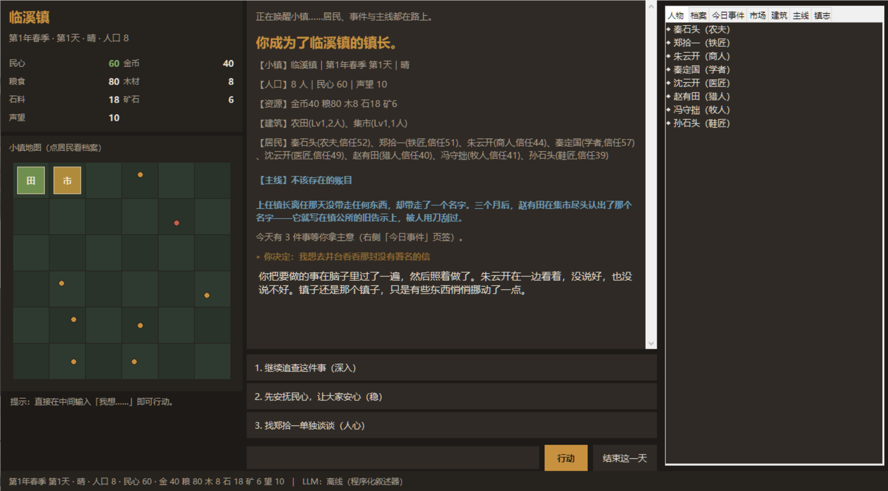

# 《AI 小镇：无限人生》

> 一个由 LLM 实时生成一切的文字 + 轻可视化模拟经营游戏。
> 你是新上任的镇长；居民、事件、主线、危机全部由 LLM 现场生成，没有两次相同的存档。



```
你输入「我想去井台看看那封没有署名的信」
        ↓
LLM 叙述结果 + 给出 3 个可选分支        ← 叙事素材（文本 + 语义标签）
        ↓
你选择其中一个分支
        ↓
确定性状态机结算资源 / 民心 / 信任     ← 数值由规则系统说了算
        ↓
写进记忆 → 下一次生成会「翻旧账」
```

---

## 一、快速开始

```bash
cd ai-town

python main.py                 # 启动图形界面（Tkinter）
python main.py --offline       # 图形界面但不联网：程序化叙述器照样能玩
python main.py --sim --days 20 # 无头模拟，打印 20 天的流水账
python main.py --autoplay --days 30 # 全 NPC 自动玩：AI 当镇长，世界自己跑
python main.py --selftest      # 跑单元测试（113 项）
python main.py --doctor        # 检查 LLM 连通性
```

> 需要 Python 3.10+（本机实测 3.14.10），Tkinter 随 Python 自带，无需 pip 安装。

### 操作指南（玩家手册）

- 手册文件：**[`ai_town/GUIDE.md`](ai_town/GUIDE.md)** —— 10 页：开始之前 / 一分钟上手 / 界面导览 /
  核心操作 / 数值系统 / 建筑与人手 / 记忆与「翻旧账」/ 结局 / LLM 与离线模式 / 常见问题。
- 游戏内：菜单「**帮助 → 操作指南**」会**直接读取上面这个文件**渲染成多页手册
  （实现见 `ai_town/ui/guide.py`），所以改文件就等于改游戏里的手册，不会出现两份文档各说各话。
- 界面截图：[`docs/guide.png`](docs/guide.png)

## 二、LLM 配置（MiniMax 在线）

本机走 **MiniMax**（OpenAI 兼容端点），配置在 `config.json`：

```json
{
  "backend": "auto",
  "minimax_url": "https://api.minimax.cn/v1",
  "minimax_model": "MiniMax-M3.1-Flash",
  "api_key": "",
  "reasoning_effort": "low"
}
```

`api_key` 留空即可，程序会按这个顺序自动找：

1. 环境变量 `MINIMAX_API_KEY` / `AITOWN_MINIMAX_KEY` / `OPENAI_API_KEY`
2. 项目里的 `config.json`
3. `~/.tea_agent/provider.yaml` 的 `minimax:` 段（复用本机已配置好的账号）

其他后端也可以直接切：

```bash
set AITOWN_BACKEND=ollama        # 本地 Ollama
set AITOWN_BACKEND=openai        # 任意 OpenAI 兼容端点（LM Studio / vLLM）
set AITOWN_BACKEND=offline       # 完全离线
```

### 关于 MiniMax-M3.1-Flash 的三个坑（实测）

| 现象 | 原因 | 对策 |
|---|---|---|
| `thinking.type=disabled` 报 400 | 该模型是**自适应思考**，不允许关思考 | 改用 `reasoning_effort: "low"` |
| `content` 为空、`finish_reason=length` | 思考 token 把 `max_tokens` 吃光了 | `max_tokens` 给到 4000，且提示词要短 |
| 单次调用 100 秒 | 提示词越啰嗦，它想得越久 | 提示词写死字段长度上限后降到 6~10 秒 |

`reasoning_split: true` 会把思考过程单独放进 `reasoning_content`，解析器在 `content` 里找不到 JSON 时会再去那里捞一次。

## 三、玩法

| 系统 | 谁在负责 |
|---|---|
| NPC 生成（姓名 / 性格 / 背景 / 秘密 / 关系网） | LLM，关系网由状态机补全 |
| 每日 3~5 个事件（天灾 / 人情 / 商机 / 悬案 / 日常） | LLM 出题，状态机结算 |
| 主线剧情（3 阶段 + 线索 + 奖励） | LLM，阶段推进由状态机判定 |
| DM 模式：玩家随便输入 | LLM 裁决，输出叙事 + 3 个分支 |
| 经济（商品 / 价格波动 / 商队求购） | **LLM 定风向**（走俏 / 滞销 / 商队求购），状态机算价格 |
| 记忆驱动「翻旧账」 | 确定性检索 + 模板回调，LLM 只负责把它写进提示词 |
| NPC 关系网演化 | 状态机每日演化（同工相熟 / 久不往来变淡 / 流言伤信任） |
| 18 种结局 | 纯确定性，按行为模式判定 |

**关键设计：LLM 不直接改数值。** 它只能从一张固定词表里挑「语义标签」：

```json
{"kind": 1, "coin": -8, "trust:n_3": 2, "build:market": 1, "risk": "high"}
```

由 `state.resolve_effects()` 查表换算成具体数值。这样既有生成式随机性，又不会数值崩盘。

### 三个「LLM 参与但不碰数值」的系统

| 系统 | LLM 负责 | 状态机负责 |
|---|---|---|
| **行情风向**（`agents/world.py::generate_market_brief`） | 从商品白名单里挑走俏 / 滞销 / 商队求购，外加一句行情消息 | 价格偏置（走俏 +7%/天、滞销 -6%/天）、商队求购数量、行情漂移 |
| **翻旧账**（`ai_town/callbacks.py`） | 提示词里附带「最该翻的旧事」，让叙述呼应玩家过去 | 记忆检索打分、旧事分类、事件注入（每天最多一件，仍保持 3~5 件） |
| **关系网**（`state.py::evolve_relations`） | 事件里可以用 `relation:<id>:<id>` 顺手改两人关系 | 每日演化：同工相熟、交好的替你说话、结怨的拆台、流言累积 |

```python
# 行情风向的输入输出长这样（LLM 只输出这四个字段）
{"hot": ["food"], "cold": ["ore"], "caravan_hint": ["food"], "news": "春旱未解，粮食趋紧"}
```

翻旧账事件的正文一定会点名「第几天你做了什么」，例如：

> 【旧账被翻出来】祠堂的门上贴着一张纸，写着：你选择了「加税三成」。没有落款，可镇上每个人都认得那是谁干的。

## 四、全 NPC 自动玩

不想动手也能看：把镇长交给 AI 代理，NPC 照旧自主行动。

```bash
python main.py --autoplay --days 30                # AI 当镇长（在线，LLM 决策）
python main.py --autoplay --days 30 --policy rule  # 纯规则镇长（离线、秒级）
```

每一轮自动做四件事：

1. **NPC 自主行动** —— 有人来求粮、有人求职、有人吵起来、有人要搬走；
   还有些事居民自己就办了（私下和解、结下梁子、传闲话），**不需要镇长点头**。
2. **AI 镇长决策** —— 今天做什么、每件事怎么裁、用什么倾向（省钱/求稳/施恩/冒险/追查）。
3. **执行** —— 照常走 DM 叙事并挑一个分支。
4. **推进一天** —— 产出、口粮、税收、行情、商队、翻旧账一律照算。

实现：`ai_town/npc_life.py`（NPC 自主行为）+ `ai_town/agents/autopilot.py`（AI 镇长）+ `ai_town/autoplay.py`（主循环）。
自动玩与真人玩走同一条代码路径，出来的结局也是合法结局。

---

## 五、目录结构

```
ai-town/
├── main.py                  # 入口（界面 / 模拟 / 自测 / 体检）
├── config.json              # LLM 配置
├── ai_town/
│   ├── models.py            # 数据模型：NPC / 事件 / 建筑 / 任务 / 记忆
│   ├── rng.py               # 确定性随机（带命名子流）
│   ├── state.py             # ★ 确定性状态机：资源、建筑、日循环、效果结算
│   ├── economy.py           # 商品、价格波动、商队（含行情偏置）
│   ├── endings.py           # 18 种结局判定
│   ├── callbacks.py         # ★ 记忆检索 + 「翻旧账」事件回调
│   ├── game.py              # 编排层：把状态机 / Agent / LLM 串成闭环
│   ├── sim.py               # 无头模拟器
│   ├── save.py              # 存档读档（JSON，带版本号）
│   ├── llm/
│   │   ├── client.py        # 后端适配（minimax / openai / ollama / offline）
│   │   ├── prompts.py       # 提示词（给规则，不给剧本）
│   │   └── parsing.py       # 健壮 JSON 解析 + 结构校验
│   ├── agents/world.py      # Agent 层：NPC / 事件 / DM / 主线 / 对话
│   ├── fallback/narrator.py # ★ 程序化叙述器（离线可玩 + LLM 兜底）
│   ├── npc_life.py          # ★ NPC 自主行为（求助/争吵/出走/私事）
│   ├── autoplay.py          # ★ 全 NPC 自动玩主循环
│   ├── agents/autopilot.py   # ★ AI 镇长（LLM 策略 + 规则策略）
│   └── ui/app.py            # Tkinter 前端
├── tests/                   # 113 项单元测试
└── tools/                   # 冒烟脚本与调试脚本
```

## 六、界面

```
┌──────────────┬────────────────────────┬──────────────┐
│ 镇长状态     │  叙事面板               │ 人物/档案    │
│ 资源面板     │  （LLM 写的故事）        │ 今日事件     │
│ 小镇地图     │                        │ 市场/建筑    │
│ （点居民）   │  ① ② ③ 分支按钮        │ 主线/镇志    │
├──────────────┴────────────────────────┴──────────────┤
│ [ 我想……                              ] [行动][结束这一天] │
└──────────────────────────────────────────────────────┘
```

地图上的圆点是居民（绿=信任高 / 黄=一般 / 红=不信你），方块是建筑。

## 七、测试与验证

```bash
python -m unittest discover -s tests -v   # 113 项单元测试
python tools/ui_smoke.py                   # UI 冒烟（建窗口→行动→雇工→推进一天→销毁）
python tools/llm_smoke.py                  # 在线 LLM 冒烟（居民/主线/事件/行情/DM）
python tools/shot.py ui.png                # 界面截图（--tab=market 可指定页签）
```

`tools/probe/` 是排查 MiniMax 输出格式与耗时问题时写的探针脚本（见该目录 README），留着有用。

## 八、扩展点

- **加新结局**：在 `endings.py` 的 `ENDINGS` 里加一条（`check` 是任意判定函数）。
- **加新翻旧账桥段**：在 `callbacks.py` 的 `_make()` 里加一个 `kind` 分支。
- **加新商品**：在 `economy.py` 的 `GOODS` 里加一项，并同步 `llm/parsing.py` 的 `MARKET_GOODS` 白名单。
- **加新建筑**：`state.py` 的 `BUILDING_DEFS` + `_building_flow`。
- **换提示词**：`llm/prompts.py`，注意保持短（见上文「三个坑」）。
- **加新后端**：继承 `llm/client.py` 的 `Backend` 基类，实现 `complete()` 即可。

## 九、已知限制

- MiniMax 单次调用 6~10 秒（思考型模型的固有成本），界面已用后台线程 + 状态提示处理，不卡 UI。
- LLM 偶尔输出坏 JSON，已用「修复 + 容错解析 + 最长片段扫描」三层兜底，仍失败则回退程序化叙述器。
- 地图是 6×6 网格的轻可视化，不是 3D。
- 截图脚本要按 DPI 缩放换算坐标：本机物理屏 2560×1440、Tk 逻辑 1463×823（175%），
  直接按 Tk 坐标抓只会截到窗口左边一半，`tools/shot.py` 已自动处理。
