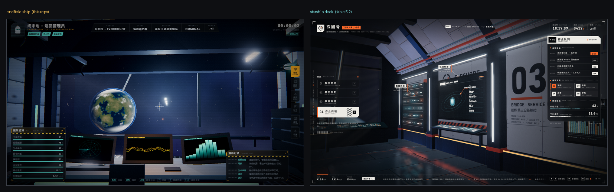

# 对比报告：`endfield-ship` vs `starship-deck`

> 同提示词、两个模型、两套独立实现的三维舰桥场景横向对比。
> 本文只记录**实测得到**的差异，不做推测性归因。

---

## 元信息

| | 本仓库（`endfield-ship/`） | 对比方（`tanskeran/starship-deck`） |
| --- | --- | --- |
| 作品名 | 终末地 · 舰桥观测舱 | 玄圃号 · 舰桥终端（XUANPU-07） |
| 仓库 | 本仓库 `endfield-ship/` | [github.com/tanskeran/starship-deck](https://github.com/tanskeran/starship-deck) |
| 生成模型 | `minimax / MiniMax-M3.1-Flash` | 对方自述为 `fable 5.2` |
| 模型来源 | 本机 tea_a2 `GET /api/health` 实测确认 | ⚠️ 见下方说明 |
| 运行载体 | tea_a2 v1.5.5（1M 上下文，支持工具/视觉） | 未知 |
| 代码规模 | 7,068 行 / 215 KB / 18 文件（含 1,266 行测试工具） | 2,268 行 / 137 KB / 7 文件 |
| 依赖 | three ^0.186.1 | three ^0.170.0 |
| 构建方式 | 原生 ESM + importmap，**可选**走 vite | 原生 ESM + importmap，零构建 |
| 资源 | 全部运行时程序化生成，零外部资源 | 同上 |

### ⚠️ 模型署名的一处不确定性

本仓库这一侧可以独立核实：本机 tea_a2 的 `GET /api/health` 返回
`model: "MiniMax-M3.1-Flash"` / `provider: "minimax"`，`GET /api/providers` 列出的可用模型为
`minimax/MiniMax-M3.1-Flash`、`deepseek/deepseek-flash`、`62/qwen3.8-27b`、
`mimo/mimo-v2.6-flash|pro`、`local/Hermes3.6-35B-A3B-Uncensored-Genesis-V7`。

**`fable` 不在本机 provider 注册表里**，无法核实。因此对方使用的具体模型只能按其自述记录，
本文的结论**不依赖**该署名是否准确 —— 下面所有结论都基于对**产物本身**的测量。

---

> 左边本仓库（`endfield-ship`，1600×900），右边 `starship-deck`（同机、同无头浏览器复拍的 1600×900）。

## 0. 一句话结论

**视觉成品度：`starship-deck` 明显更强**（光影戏剧性、空间尺度、UI 信息密度）；
**工程严谨度与可验证性：`endfield-ship` 明显更强**（116 项自动化断言，对方为 0）。

两者技术路线几乎一致（原生 ESM + importmap + three.js + 程序化贴图 + EffectComposer 后期），
差距不在「会不会做」，而在**美术预算的取舍**与**工程投入的分配**。

---

## 1. 验证方法

结论不能只看对方仓库里的截图，所以全部数据都是**实跑测出来的**：

1. `git clone --depth 1` 对方仓库 → `npm install` → `node serve.mjs`，
   在**同一台机器、同一套无头 Edge（SwiftShader 软件渲染）**下实跑；
2. 用 CDP 驱动页面：等待启动序列结束、按 `1`–`4` 切视角、敲 `T`/`H` 等按键，
   逐个截图（`screenshots/` 4 张 + 我方复拍 5 张）；
3. 渲染统计用 `info.autoReset=false; info.reset(); renderer.render(scene,camera)` 单渲一遍再读
   —— 直接读 `renderer.info.render` 拿到的是**最后一个后期 pass**（全屏 quad）的数字（`calls:1`），
   不是场景真实绘制量；
4. 声音用 `Page.addScriptToEvaluateOnNewDocument` 在页面脚本之前替换 `AudioContext` 构造函数、
   包装 `HTMLMediaElement.play`，统计实例与节点创建次数；
5. 帧率用 **rAF 间隔**（中位数，50 帧）—— `performance.now()` 包住 `render()` 测不出真实耗时，
   因为 WebGL 命令是异步入队的，耗时只有同步呈现时才计入。

复现脚本见 `.tea_agent_run/scripts/cmp-*.{mjs,py}`（会话工作区，不入库）。

---

## 2. 逐维度对比

### 2.1 画面（客观指标，1600×900 / 1920×1080）

| 指标 | `starship-deck` | `endfield-ship` | 判读 |
| --- | --- | --- | --- |
| 平均亮度 | 44.2 ~ 71.0 | 32.6 ~ 45.3 | 对方更亮 |
| 对比度 SD | 48.0 ~ 59.6 | 37.5 ~ 55.6 | 对方更硬 |
| 过曝占比 | 0.00 ~ 0.17% | 0.00 ~ 0.63% | 相当，我略高 |
| **死黑占比** | **0.8 ~ 8.4%** | **16.3 ~ 30.8%** | **我明显更差** |
| 边缘密度（细节量） | 8.2 ~ 14.0% | 8.7 ~ 11.8% | 对方更密 |
| **平均饱和度** | **0.23 ~ 0.34** | **0.62 ~ 0.66** | **我高 2~2.5 倍，明显过艳** |

死黑与饱和度这两条是本报告里**对我方最不利**的客观数据，也是最容易改的两条。

### 2.2 渲染实现

| | `starship-deck` | `endfield-ship` |
| --- | --- | --- |
| Draw call | 225 | 165 |
| 三角形 | 118,689 | 59,682 |
| 网格对象 | 145 | 211 |
| 几何体 / 贴图 | 75 / 69 | 125 / 30 |
| 着色器程序 | 87 | 43 |
| 灯光数 | 7 | 14 |
| 后期链 | Render → **GTAO** → Bloom → Output → **FXAA** → Grade | Render → Bloom → Output → Grade |
| Bloom | `.3 / .6 / 1.0` | `.32 / .4 / .92` |
| 阴影 | 4096 + `radius 2.2` + `blurSamples 12` | 2048，硬边 |
| 主光 | Directional **7.5** + SpotLight **150** | Directional 2.1 |
| MSAA | 4x（高画质） | 无 |
| 地面镜面反射 | 有（额外渲一遍到 mirrorRT） | 无 |
| 几何合并 | `mergeGeometries` | 无 |

**关键差异是 GTAO + 软阴影 + 戏剧性主光这三条**，它们直接决定「物体像不像坐在舱里」。

### 2.3 光照

| | `starship-deck` | `endfield-ship` |
| --- | --- | --- |
| 平行光 | 7.5（投影，4096，radius 2.2） | 2.1（投影，2048，无 radius） |
| 聚光灯 | 150（投影） | 无 |
| RectAreaLight | 2 盏 | 1 盏 |
| 点光源 | 1 盏 | **12 盏** |
| 半球光 | 0.3（低画质时 0.62） | 0.55 |
| 环境贴图强度 | 0.9 ~ 1.2（按档位） | 0.72 |

我方用 12 盏点光做「平均铺亮」，对方用一盏强主光 + 一盏聚光做「戏剧性塑形」。
后者体积感更强，前者更平 —— 这也是我死黑率高的直接原因（详见 §4）。

### 2.4 性能（SwiftShader 软件渲染，1920×1080，帧间隔中位数）

| 配置 | 帧耗时 | 帧率 |
| --- | --- | --- |
| 对方 · 自动档（降到「低」） | 4.2 ms | **238 fps** |
| 对方 · 强制中画质 | 1,203.9 ms | 0.8 fps |
| 对方 · 强制高画质 | 1,949.6 ms | 0.5 fps |
| 我方 · 现状 | 145.9 ms | 6.9 fps |
| 我方 · 关掉 7 盏点光源 | 100.0 ms | 10.0 fps |
| 我方 · 再关阴影 | 91.8 ms | 10.9 fps |

> **这一组数据推翻了我最初的口头结论。** 第一轮只测了「对方自动档 vs 我方现状」，
> 得出「对方快 34 倍」的印象；实际上那是**对方自动降档**的功劳
> ——「低」档会关掉 GTAO、MSAA、两盏 RectAreaLight，并把 Bloom 降到半分辨率。
> **同画质档位下，对方比我方慢 3~4 倍**（高画质 0.5 fps vs 我方 6.9 fps），
> 因为 GTAO + MSAA 4x + 镜面反射（多渲一遍）+ 全分辨率 Bloom 都很贵。
>
> 诚实的结论是：**对方的画质自适应系统是更成熟的工程决策**（弱机自动降到底、绝不卡死），
> 但**对方的高画质路径本身比我的更重**。在真实 GPU 上我方会更轻。

### 2.5 交互

| | `starship-deck` | `endfield-ship` |
| --- | --- | --- |
| 视角切换 | `1`–`4` 四个预置机位（带缓动运镜） | `1`–`5` 聚焦热点 + `Esc` 返回全景 |
| 自由视角 | 仅鼠标视差（`pointer`） | OrbitControls：拖拽环视 + 滚轮推拉 |
| 3D 空间热点标签 | **5 个**（带引线卡片，投影跟随） | 0（热点只在聚焦面板里） |
| 侧栏面板 | 1 个（右侧随视角换内容） | 3 个（遥测 / 通讯 / 聚焦） |
| 菜单项 | 4 个 | 0（改为右侧竖排按钮） |
| **可输入文本** | **0** | **1（PRTS 终端，真能敲 9 条指令）** |
| 按钮 / kbd 提示 | 5 / 5 | 1 / 6 |
| 其它 | `H` 影像模式、`Q` 切画质 | `T` 开终端、`H` 隐藏 HUD |

对方胜在**信息密度与空间化呈现**（3D 热点卡把数据贴在物体上）；
我方胜在**交互深度**（终端能真正驱动程序，不是装饰）。

### 2.6 🔊 声音

**两个项目都完全无声。** 这一项是运行时插桩实测的，不是看代码猜的：

| 探针 | `starship-deck` | `endfield-ship` |
| --- | --- | --- |
| `AudioContext` 实例 | 0 | 0 |
| `createOscillator` | 0 | 0 |
| `createGain` | 0 | 0 |
| `createBufferSource` | 0 | 0 |
| `createBiquadFilter` | 0 | 0 |
| `createStereoPanner` | 0 | 0 |
| `HTMLMediaElement.play()` 调用 | 0 | 0 |
| `<audio>` / `<video>` / `<source>` 元素 | 0 / 0 / 0 | 0 / 0 / 0 |
| 音频资源文件（mp3/wav/ogg/m4a/flac） | 无 | 无 |

> 补充说明：静态 grep 在我方代码里报过两处命中（`BASE_TELEMETRY`、`NOISE_GLSL`），
> 那是正则 `se_` 的**误匹配**，不是音频代码。运行时探针是零误报的依据。

**这是两个作品共同的、也是最大的缺口。** 对一个号称「3A 感」的舰桥终端而言，
声音承担了很大一部分沉浸感：

- 明日方舟/终末地的 UI 音效本身就是识别符号（点击、确认、警告、切换面板）；
- 舰桥场景离不开**环境底噪**（生命维持的风机、反应堆低频嗡鸣、结构应力）；
- 告警音是遥测数据**唯一能穿透注意力**的通道 —— 我方 HUD 上已经有
  `warning` / `critical` 两级严重度，但它们只有颜色变化，**没有声音**；
- 启动序列（我方 9 行自检日志）配逐行滴答，是最自然的「仪式感」来源。

**若要补齐，建议的方向**（与本项目「零外部资源」的原则一致，全部用 Web Audio 合成）：

| 声音 | 合成方式 |
| --- | --- |
| 环境底噪 | 粉噪 + 低通（生命维持风噪）+ 40~60 Hz 低频振荡（反应堆嗡鸣），两个 `GainNode` 交叉淡入 |
| UI 点击 / 确认 | 方波或三角波短音（20~40 ms）+ 带通 + 快速指数衰减 |
| 面板切换 | 噪声脉冲 + 扫频滤波（升调 = 进入，降调 = 退出） |
| 遥测告警 | 两声不谐和正弦（440 + 466 Hz），比单音更刺耳 |
| 启动序列 | 每行日志一个短滴答，音高随行号递增，最后一声长音 |
| 终端回车 | 低频方波 click + 轻微失真 |

工程上要注意：浏览器自动播放策略要求**首次用户手势**后才能 `ctx.resume()`，
所以声音必须在「进入舰桥」按钮上解锁；并且要提供静音开关与音量记忆。

### 2.7 工程与验证

| | `starship-deck` | `endfield-ship` |
| --- | --- | --- |
| 自动化测试 | **0** | **116 项**（70 离线断言 + 46 无头 E2E） |
| 语法自检工具 | 无 | `tools/lint.mjs`（`node --check` 逐文件） |
| 截图体检工具 | 无 | `tools/inspect.py`（区域亮度 / 过曝占比 / ASCII 局部预览） |
| 纯逻辑与渲染分离 | 无（逻辑混在 `scene.js`） | 有（`src/core.js` 不依赖 DOM 与 three） |
| 模块划分 | 4 个源文件，`scene.js` 871 行 | 10 个源文件，按 `world/` `ui/` 分目录 |
| 文档 | README 简洁（无踩坑记录） | README 记录 10 条实测踩坑 |
| 画质分档 | 3 档 + 自动测速（`readPixels` 卡帧，budget 21 ms） | 无分档，仅 fps<26 时降 `pixelRatio` |
| 可脱离打包器运行 | 是 | 是（且额外支持 vite dev/build） |

### 2.8 内容与设定

| | `starship-deck` | `endfield-ship` |
| --- | --- | --- |
| 空间尺度 | 整间舰桥（环形吊灯、扶手、玻璃幕墙、地面反射） | 一间舱室（11 × 15 × 5 m） |
| 行星 | **烘焙贴图**（`bake()` 把 shader 渲进 RT，192×128 球 + 大气壳） | **实时 fbm 着色器**（128×96 球：大陆/云/晨昏线/夜面城市灯 + fresnel 大气 + 缓慢自转） |
| 标志性元素 | 地面镜面反射、环形吊灯 | **天梯缆索**（贯穿行星与轨道）、巡检无人机、PRTS 终端 |
| 界面风格 | 钢灰 + 少量橙，低饱和，信息密集 | 青 + 琥珀，高饱和，方言化的 ARK 风格 |
| 设定 | 远岸勘测局 · 深空测绘舰 | 泰拉II 轨道站「长明号」· 轨道巡防舰 |

---

## 3. 差异归因（我能确证的部分）

技术路线几乎相同，所以差异集中在**四个取舍**上：

1. **光预算**：对方把预算压在 1 盏强主光 + 1 盏聚光上，换来体积感；
   我方用 12 盏弱点光平均铺亮，换来「哪儿都看得见」，但画面平、死黑多。
2. **几何预算**：对方贴图 69 张、三角形 11.9 万，用密度换真实感；
   我方贴图 30 张、三角形 6 万，把预算挪给了测试工具与独立模块。
3. **后期预算**：对方 GTAO + MSAA + FXAA + 镜面反射；
   我方只有 Bloom + 调色，代价是硬阴影、边缘毛刺、物体缺接触阴影。
4. **工程预算**：对方 0 测试、2,268 行；我方 116 项断言、7,068 行。
   同一份提示词下，**多出来的代码去了不同的地方**。

---

## 4. 我方该补什么（按性价比排序，全部可直接执行）

| # | 事项 | 预期收益 | 改动量 |
| --- | --- | --- | --- |
| 1 | **接上 GTAO**（`GTAOPass`，高/中档开、低档关） | 物体「坐实」，接触阴影立竿见影 | 约 20 行 |
| 2 | 软阴影：`shadow.radius = 2.2`、`blurSamples = 12`、mapSize 4096 | 阴影不再像贴片 | 3 行 |
| 3 | MSAA 4x：`composer.renderTarget1.samples = 4` | 几何边缘毛刺消失 | 2 行 |
| 4 | 主光 2.1 → 6~7，并加一盏 `SpotLight` 打光池 | 体积感、层次 | 约 15 行 |
| 5 | 抬环境光 / 加边缘补光，压死黑率 30% → 10% | 直接改善「发闷」 | 约 10 行 |
| 6 | 饱和度 0.64 → 0.35（青/琥珀各压一档） | 从「艳」变「高级」 | 调色常量 |
| 7 | Bloom threshold 0.92 → 1.0 | 只让真高光溢出 | 1 行 |
| 8 | 3 档画质 + `autoQuality`（`readPixels` 卡帧） | 弱机不卡死 | 约 40 行 |
| 9 | 3D 空间热点标签（带引线的卡片，投影跟随） | 补上对方最强的一点 | 约 80 行 |
| 10 | **声音**（§2.6 的合成方案） | 补上两个作品共同的最大缺口 | 约 300 行 |

第 1~7 条属于「把已有信息用对」，成本低、收益直接；
第 8 条是工程决策；第 9~10 条是工作量更大的补强。

---

## 5. 局限与不能断言的部分

诚实起见，明确列出本文**无法**结论的部分：

1. **提示词是否真的一致，我无法独立验证**，只能采信「相同提示词」这一前提。
2. **对方模型无法核实**（`fable` 不在本机 provider 注册表内）。
   本文所有结论都基于产物测量，因此不受该署名真伪影响；但
   「换一个模型能否复现同等水平」这个问题，本文**无法回答**。
3. **迭代轮次不可比**。本项目的开发过程有完整记录（`.tea_agent_run/agent.md`），
   期间对着截图反复改了十几轮（行星构图、无人机尺寸、窗棂位置、过曝、饱和度……）；
   对方仓库只呈现最终态，迭代次数未知。
   → 因此**不能把成品差距直接归因到模型能力**。
4. **截图分辨率不同**（对方 1920×1080，我方 1600×900）。
   客观指标已按各自原生分辨率测；另已用同一台机器、同一分辨率复拍对方做视觉对齐。
5. **软件渲染 ≠ 真实 GPU**。§2.4 的帧率数字来自 SwiftShader，只用于**横向相对比较**
   与定位瓶颈，不可当作真实设备性能。
6. **无头环境会影响音频**：浏览器自动播放策略在无头下更严格。
   不过两个项目在**有头浏览器**下的表现未做对照，因此「两者皆无声」的结论
   基于代码路径与运行时探针（`AudioContext` 从未被构造），
   而非仅仅「没听见声音」。

---

## 6. 最终判断

- **要「看起来像 3A」**：`starship-deck` 是更好的范本 —— 它在光影、尺度、信息密度上
  更接近成品，代价是没有分档时会更吃性能。
- **要「像工程一样交付」**：`endfield-ship` 更完整 —— 116 项断言、可脱离打包器运行、
  纯逻辑可离线验证、README 留了踩坑记录，代价是画面偏暗偏艳、场景偏小。
- **两者共同的最大缺口是声音**，其次是我方的死黑率与过饱和。
- 换模型能不能做出同水平作品，本文没有证据；但**同一个模型下，
  把预算花在光影密度还是花在测试与模块化上，成品取向就会明显不同** ——
  这点本对比是清楚的。
