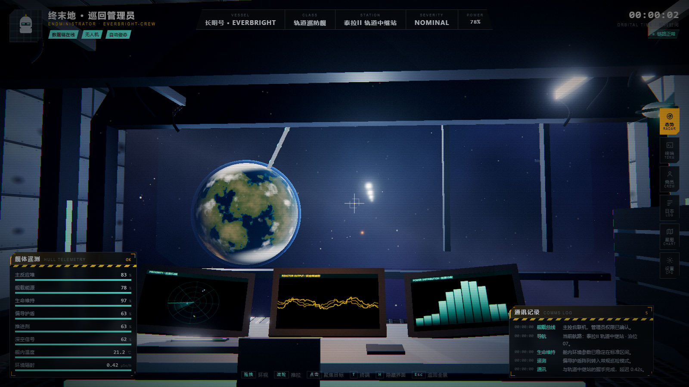

# 🚀 终末地 · 舰桥观测舱

**《明日方舟：终末地》风格的飞船内舱场景** —— 泰拉II 轨道中继站「长明号」的舰桥观测舱。

一面梯形观景舷窗外是**泰拉II 行星**与贯穿行星与轨道的**天梯缆索**；
舱内是主控台、全息战术台、生命维持机柜、货舱闸门，和一台在舱内巡航的巡检无人机。
最上层覆盖的是一整套**明日方舟风格的 HUD**：斜切面板、角标括号、黄黑警示条、
中英双语标签、等宽数据、PRTS 终端、通讯日志。

> 场景规模刻意做小（一间舱室），但每一处都按 3A 的标准来推：
> PBR 材质 + 程序化贴图 / PMREM 环境光 / 软阴影 / 体积光 / Bloom + 调色后期。

---



## 🚀 运行

```bash
# 方式一：独立静态服务器（不需要打包，浏览器直接跑原生 ESM）
node endfield-ship/tools/serve.mjs
#   → http://127.0.0.1:5178/endfield-ship/

# 方式二：仓库自带的 vite（会一起打包这个页面）
npm run dev
#   → http://127.0.0.1:5173/endfield-ship/
```

> ⚠️ **不能直接双击 `index.html`**：页面用的是原生 ESM + `importmap`，
> 浏览器在 `file://` 下会拦截模块加载。用上面任一方式即可。

---

## 🎮 操作

| 操作 | 效果 |
| --- | --- |
| 拖拽 | 环视舱室 |
| 滚轮 | 推拉镜头 |
| 悬停可交互物 | 出现名称提示 |
| 点击可交互物 | 相机运镜到该处 + 右侧弹出详情面板 |
| `1` ~ `5` | 直接聚焦主控台 / 全息台 / 舷窗 / 机柜 / 闸门 |
| `T` | 打开 / 关闭 PRTS 终端（可真的敲指令） |
| `H` | 隐藏 / 恢复 HUD |
| `Esc` | 关闭面板并返回全景 |
| 右侧竖排按钮 | 态势 / 终端 / 乘员 / 日志 / 星图 / 设置 |

### 终端指令

打开终端后可以直接输入：

```
help              显示全部指令
status            打印当前舰体遥测摘要
scan              对当前扇区做一次深空扫描
logs              回放最近 6 条通讯记录
time              显示舰内时间与轨道相位
drone on|off      启停巡检无人机
autopilot on|off  启停自动姿态控制
focus <id>        聚焦某个舱段
clear             清空终端输出
```

---

## 🎨 界面为什么长这样

明日方舟的 UI 辨识度来自一整套「工业 + 军规」的细节，这里逐条复刻：

| 元素 | 实现 |
| --- | --- |
| **斜切角面板** | `clip-path` 切掉左上 / 右下角，而不是圆角 |
| **角标括号** | 四角独立的 `L` 形描边（`.bracket`），强调「取景框」感 |
| **黄黑警示斜纹** | `repeating-linear-gradient` 45° 斜纹，用作面板标题下的分隔条 |
| **中英双语** | 中文主标题 + 全大写窄体英文副标，字母间距 0.22em |
| **等宽数据** | 遥测数值全部 `font-variant-numeric: tabular-nums`，跳数不抖 |
| **分段进度条** | 用「健康度」而不是「数值」映射到 0-100%，越低越糟的通道反向处理 |
| **危险区间** | 压强 / 温度这类「双向」的通道用 `{below, above}` 描述，而不是单向阈值 |
| **PRTS 终端** | 青色等宽字 + 扫描线 + 发光边框，命令是真的能跑的 |
| **启动序列** | 逐行自检日志 + 斜纹进度条 + 「进入舰桥」确认 |

---

## 🛠 技术要点

### 渲染管线

```
RenderPass → UnrealBloomPass(0.32 / 0.40 / 0.92) → OutputPass → GradePass
```

`GradePass` 是自写的调色着色器：桶形色差 → Lift/Gain 调色 → 对比度/饱和度 →
暗角 → 扫描线 → 胶片颗粒 → 危急状态边缘泛红。

### 全部程序化，零外部资源

| 资源 | 做法 |
| --- | --- |
| 船体装甲板 | Canvas 画分块 + 铆钉 + 丝印，再用 **Sobel 从高度图生成法线贴图** |
| 地板格栅 | Canvas 画承重条 + 镂空阴影，同样做法线贴图 |
| 行星 | 自写着色器：3D value noise fbm 生成大陆 + 云层 + 晨昏线 + 夜面城市灯 |
| 大气层 | 背面 fresnel 加性辉光 |
| 天梯缆索 | 圆柱 + `InstancedMesh` 分节环 + 航标灯 |
| 星野 / 星云 | `Points` + 自写着色器（闪烁、银河带、暗尘） |
| 舱内屏幕 | Canvas 动态贴图（雷达扫描 / 波形 / 柱状图 / 滚动文本），每帧重绘 |
| 全息沙盘 | 自写着色器：旋转网格 + 扫描扇 + 高度场 + 体积光锥 |
| 体积光 | 加性混合锥体 + 沿轴衰减 + 流动噪声 |

### 踩过的坑（都写在代码注释里了）

1. **rAF 时间戳可能小于 `performance.now()`** —— dt 会变成负数，把 `elapsed` 带成负数，
   之后用负数取曲线采样点就会取到 `points[-1]`（undefined）直接崩。
   → `dt` 必须夹紧下界，**相机运镜要用墙钟时间算**，否则低帧率下 1.7 秒的运镜会拖成几十秒。
2. **泛光很容易把画面糊白** —— 舱内全是自发光灯条，`strength` 稍大整幅画就糊成灰奶白
   （实测平均亮度从 36 飙到 96）。→ 阈值 0.92、强度 0.32。
3. **环境光不是越高越好** —— 给太高画面平、给太低天花板死黑（实测 avg 5.7）。
   → `hemi 0.55 + environmentIntensity 0.72`。
4. **金属度高的表面在暗环境里只剩反射**，会变成黑块 → 墙 / 天花板金属度压到 0.2~0.35。
5. **抛光金属遇到舷窗主光会过曝成白条** → 窗台 / 窗棂单独用哑光饰条材质。
6. **天花板灯槽不能给太亮** —— 它在画面最上方，一过曝就在顶部糊出一大团泛光抢走视线。
   → 天花灯条用暗一档的自发光材质，点光源下移到离天花板 2m。
7. **`readPixels` 必须紧跟在 `render()` 之后** —— 否则后缓冲已经被清掉，读出来全是 0。
8. **构图要算数，不能靠眼睛试**：
   行星在屏幕上直径约 230px，而两根窗棂之间的净空只有 258px ——
   对称窗棂一定会把行星切成两半。所以竖向窗棂全部挪到窗口右侧，左边留出完整观测净空。
   工具 `inspect.py` 可以量化每个区域的亮度、过曝占比，还能裁剪放大局部看细节。
9. **飞行器的位置也要避开主体**：巡检无人机一开始正好压在行星边缘，
   看起来像插在星球上的尖刺 —— 缩小机体并把航线整体抬高、偏右之后才正常。
10. **主机位别怼到发光体脸上** —— 全息沙盘是加性混合的自发光，
    近距离会被 Bloom 放大成一团白（过曝占比飙到 2.8%）；机位退到 3.9m 才正常。

---

## 📁 结构

```
endfield-ship/
├─ index.html              # 入口（importmap + 原生 ESM，样式用 <link> 引）
├─ src/
│  ├─ core.js              # 纯逻辑层：遥测模拟 / 事件日志 / 终端指令解析 / 格式化
│  ├─ textures.js          # 程序化贴图工厂（Canvas → 贴图 + 法线贴图）
│  ├─ main.js              # 渲染器 / 相机 / 后期 / 交互 / 主循环
│  ├─ world/
│  │  ├─ space.js          # 行星 / 大气 / 天梯 / 星野 / 星云
│  │  ├─ cabin.js          # 舱体结构 / 舷窗 / 主控台 / 机柜 / 闸门 / 灯光
│  │  ├─ props.js          # 全息台 / 货箱 / 设备柜 / 无人机 / 警示牌
│  │  ├─ shafts.js         # 体积光
│  │  └─ postfx.js         # Bloom + 调色后期链
│  └─ ui/
│     ├─ hud.js            # HUD 构建与刷新 + 启动序列
│     ├─ terminal.js       # PRTS 终端
│     └─ styles.css        # 全部界面样式
└─ tools/
   ├─ selftest.mjs         # 70 项离线断言（纯 Node，不碰浏览器）
   ├─ verify.mjs           # 46 项无头 Edge 端到端验证 + 截图
   ├─ lint.mjs             # 源码语法自检（不用打包器，语法错会整页白屏）
   ├─ inspect.py           # 截图体检：区域亮度 / 过曝占比 / ASCII 预览
   ├─ shoot.mjs            # 只截图不跑断言，用于视觉迭代
   ├─ serve.mjs            # 独立静态服务器
   └─ shots/               # 验证过程产出的截图
```

`src/core.js` 不依赖 DOM、不依赖 three.js，浏览器和 Node 都能加载，
所以核心算法（遥测模拟、指令解析、格式化）可以完全离线断言。

---

## 🧪 命令

```bash
node endfield-ship/tools/selftest.mjs   # 70 项离线断言（纯 Node）
node endfield-ship/tools/verify.mjs     # 46 项无头 Edge 端到端验证 + 截图
node endfield-ship/tools/lint.mjs       # 源码语法自检
node endfield-ship/tools/serve.mjs      # http://127.0.0.1:5178/endfield-ship/
```

无头验证依赖本机 Edge / Chromium，默认路径
`C:\Program Files (x86)\Microsoft\Edge\Application\msedge.exe`，可用环境变量覆盖：

```bash
EDGE_PATH=/path/to/chrome node endfield-ship/tools/verify.mjs
```

> 无头用的是 SwiftShader 软件渲染，帧率只有 1~5 fps，
> 所以验证脚本里所有「等一会儿」都用**轮询状态**而不是固定 sleep。

---

## 📊 同提示词横向对比

同一套提示词下，另一个模型（`fable 5.2`）也做了一套舰桥场景：[`tanskeran/starship-deck`](https://github.com/tanskeran/starship-deck)。

两边都**实跑验证**过（同一台机器、同一套无头 Edge），逐维度实测结论见
**[`docs/starship-deck-comparison.md`](../docs/starship-deck-comparison.md)**。

一句话：它**看起来更像 3A 成品**（光影戏剧性、空间尺度、UI 信息密度、3D 空间热点标签）；
我这套**更像工程交付**（116 项自动化断言、纯逻辑可离线验证、模块化、零构建可跑）。

两个作品**共同的最大缺口是声音** —— 运行时插桩实测，两个都是零发声。

---

## 📊 性能

| 指标 | 数值（1600×900） |
| --- | --- |
| Draw call | ~360 / 帧（含 5 趟后期） |
| 三角形 | ~12 万 |
| 几何体 / 贴图 | 125 / 30 |
| 着色器程序 | 27 |

低帧率时自动降 `pixelRatio`（< 26 fps 时降到 1）。

低帧率时自动降 `pixelRatio`（< 26 fps 时降到 1）。

---

## 📝 设定

- 舰船：**长明号 / EVERBRIGHT**，轨道巡防舰
- 位置：泰拉II 轨道中继站 · 泊位 07
- 视角：**终末地 · 巡回管理员 / ENDMINISTRATOR**
- 场景：舰桥观测舱（DECK 04），舷窗朝 −Z

---

## License

MIT
