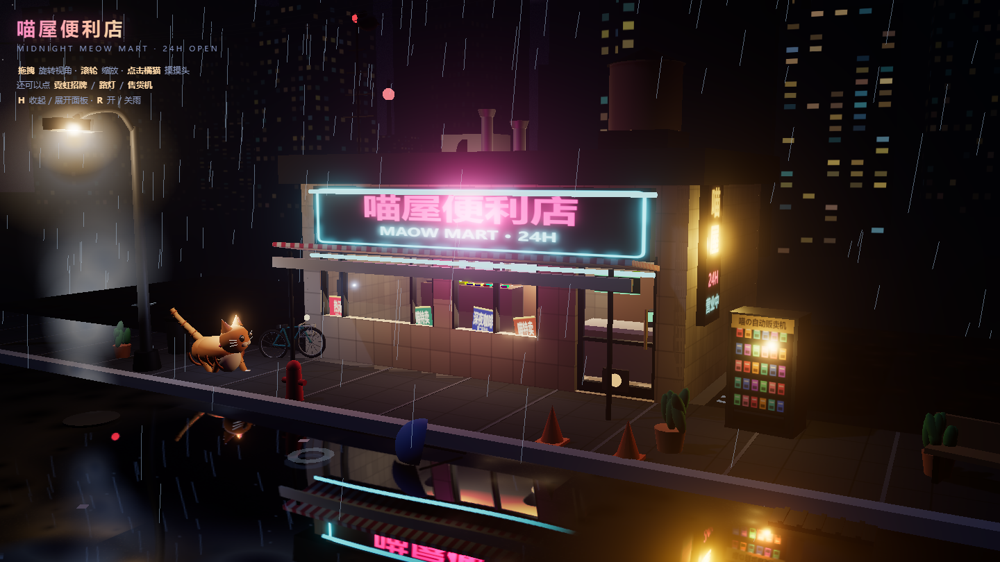

# 🐱 喵屋便利店 · Midnight Meow Mart

一个完全用 **Three.js 程序化生成**的雨夜 3D 小镇：霓虹灯便利店、会走路的橘猫、积水倒影、斜飞的雨丝、远景城市天际线。

**没有任何外部模型 / 贴图文件** —— 建筑、猫、自行车、售货机、招牌文字、瓷砖、路面全部是用代码在运行时"长"出来的（Canvas 贴图 + 基础几何体）。

> 🎪 本仓库是多项目实验场，完整索引见[根目录 README](../README.md) 或 [`docs/INDEX.md`](../docs/INDEX.md)。

---

## 快速开始

```bash
npm install
npm run dev          # http://127.0.0.1:5173/meow-mart/
```

生产构建（多页面一次出）：

```bash
npm run build        # 输出到 dist/，本页在 dist/meow-mart/index.html
npm run preview
```

> 页面在 `/meow-mart/` 下，根路径 `/` 现在是全仓库的项目索引页。

## 玩法

| 操作 | 效果 |
| --- | --- |
| 拖拽 | 旋转视角 |
| 滚轮 | 推拉镜头 |
| 点击橘猫 | 摸摸头 → 猫会开心地跳起来并冒爱心（同时弹出"喵～！"） |
| 点击霓虹招牌 | 开关招牌（关掉时会有接触不良的抽搐效果） |
| 点击路灯 | 开关路灯 |
| 点击售货机 | 哐当！掉出一罐猫罐头 |
| `H` | 收起 / 展开左上角面板 |
| `R` | 开关雨 |

闲置 9 秒后镜头会自动缓慢环绕，像拍橱窗广告一样。

---

## 场景里有什么

### 🏪 喵屋便利店（`src/world/store.js`）
- 立面用 `ExtrudeGeometry` + `Shape.holes` 挖出 **两扇橱窗 + 一扇门洞**，比拼盒子更有建筑感
- 门是独立铰链组，开合时会轻轻晃动；门上还有猫洞
- 招牌是 Canvas 画的霓虹字：**粉色店名 + 青色副标题 + 霓虹管边框**，同一张画布同时产出 `map` 和 `emissiveMap`
- 侧面竖招牌（刀旗）：喵 / 屋 / 24H / 营业中
- 屋内有货架、冷柜、收银台、咖啡机、吊灯和柜台绿植，商品用 `InstancedMesh` 随机上色
- 屋顶：空调外机（风扇会转）、水塔、通风管、天线、闪烁的航空警示灯

### 🐈 橘猫（`src/world/cat.js`）
- 纯几何体拼装：球体身体 + 圆锥耳朵 + 眼球 + 鼻头 + `LineSegments` 胡须 + 6 节链式尾巴 + 虎斑半环 + 红项圈铃铛
- 有限状态机：**走路 / 坐下 / 发呆 / 被摸头**
- 走路时四肢按对角步态摆动、身体上下起伏、尾巴左右摆；坐姿会压低后半身、收起后腿
- 会眨眼、耳朵随情绪抖动、随机转头张望
- 被点击时：跳一下、竖起耳朵、冒出上浮的爱心粒子

### 🌧️ 雨夜街景
- **天空**：自定义 Shader 天穹（顶部深蓝 → 地平线城市光污染暖光），1400 颗闪烁的星星、带光晕的月亮、薄云
- **远景**：程序化楼群剪影 + 随机亮着的窗户 + 红色航空警示灯
- **雨水**：`LineSegments` 雨丝（1500 条，带风偏斜）+ 地面随机扩散的涟漪
- **水洼**：路面材质带 `alphaMap`，水洼中心镂空露出下方的 `Reflector` 镜面，并给镜面 shader 加了水波扰动，倒影会轻轻晃动
- **道具**：路灯（带柔光光晕）、自动售货机、自行车、长椅、垃圾桶、交通锥、消防栓、盆栽、电线杆 + 垂落的电线 + 停在电线上的鸟、井盖冒出的蒸汽、绕着路灯飞的飞蛾

### 🎬 渲染与后处理
- `WebGLRenderer` + ACES Filmic 色调映射
- `EffectComposer`：`RenderPass` → `UnrealBloomPass`（霓虹辉光）→ `OutputPass`
- 阴影：平行光（月光）PCF 阴影 + 路灯点光源的立方体阴影
- IBL：用一张手绘渐变天空经 `PMREMGenerator` 生成环境贴图，让玻璃和金属有夜色的反光
- `RectAreaLight` 模拟橱窗洒到人行道上的暖光

---

## 目录结构

```
meow-mart/
├─ index.html           页面骨架 / HUD / 加载动画
├─ docs/preview.png     预览图（README 与根索引页共用）
└─ src/
   ├─ main.js           渲染器 / 相机 / 后处理 / 交互 / 主循环
   ├─ style.css         HUD 与加载动画
   ├─ util/
   │  ├─ rng.js         线性同余伪随机（保证每次生成的场景一致）
   │  ├─ textures.js    Canvas 贴图工厂（沥青 / 瓷砖 / 霓虹 / 海报 / 售货机…）
   │  └─ puddle.js      水洼遮罩
   └─ world/
      ├─ sky.js         天穹 / 星空 / 月亮 / 云
      ├─ skyline.js     远景楼群
      ├─ street.js      路面 / 人行道 / 水洼镜面
      ├─ store.js       便利店建筑与店内陈设
      ├─ cat.js         橘猫模型与行为
      ├─ props.js       街道道具
      └─ rain.js        雨丝与涟漪
```

## 性能

- 全场约 300 个几何体 / 50 张贴图，每帧约 800 个 draw call（其中一半来自水洼镜面的第二次渲染）
- 远景楼群用 `mergeGeometries` 合并成 2 个 Mesh，商品用 `InstancedMesh`
- 路灯点光源**不投影**（立方体阴影要渲 6 遍，代价太大），只保留月光平行光的阴影
- 内置自适应画质：检测到帧率低于 24fps 时会自动关闭水洼反射与阴影（软件渲染器不触发）

## 技术要点

1. **水洼反射**：镜面放在 `y=0.008`，路面平面放在 `y=0.03` 并用 `alphaMap` 把水洼区域"挖空"，于是水洼处直接看到镜子，边缘平滑过渡回沥青。
2. **霓虹字**：Canvas 同时绘制彩色版与纯发光版两张贴图，配合 `emissiveIntensity` + Bloom，得到接近真实霓虹管的观感。
3. **透视立面**：`Shape` + `Path` 洞 → `ExtrudeGeometry`，一次性得到带真实窗洞的墙体，玻璃再单独贴上去。
4. **性能**：商品用 `InstancedMesh`，雨丝共用一个 `BufferGeometry`，全场约 100 个 draw call 量级。

## License

MIT
