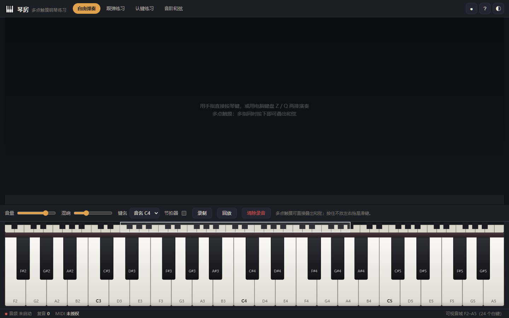
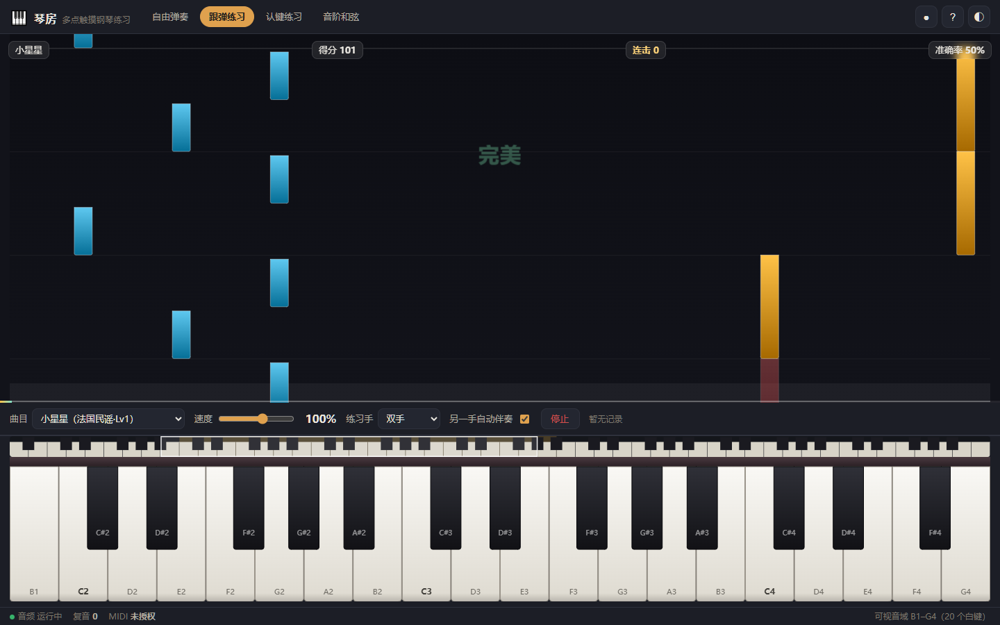
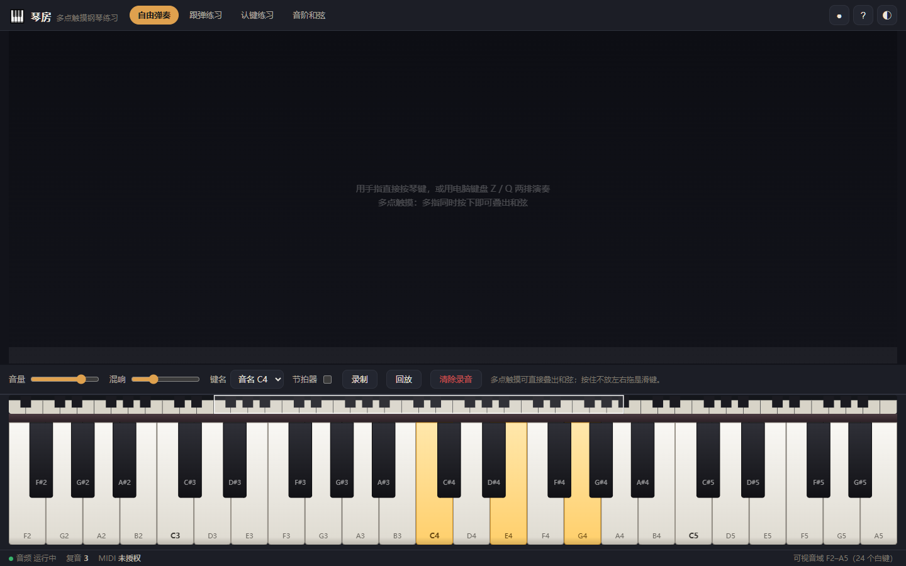

# 琴房 · 钢琴练习

多点触摸的网页钢琴练习应用。原生 HTML + CSS + JS，**零依赖零构建**，双击 `index.html` 就能用。



| 跟弹练习（瀑布流） | 多点触摸叠和弦 |
| --- | --- |
|  |  |

---

## 快速开始

| 方式 | 操作 | 说明 |
| --- | --- | --- |
| **直接双击** | 打开 `piano/index.html` | `file://` 协议，零依赖零配置，**推荐** |
| 本地 HTTP（可选） | `npx serve piano` 或任意静态服务器 | 与 `file://` 行为一致，便于调试 |

> `file://` 下用**经典 `<script>`** 加载（不用 ES module、不 fetch 本地 JSON），所以双击就能跑。
> 设置与最佳成绩存在本机 `localStorage`（键名 `piano-studio/settings/v1`、`piano-studio/best/v1`）。

---

## 核心能力

### 🎹 多点触摸（真·多指复音）

- 每个手指独立跟踪（`PointerEvent.pointerId`），**多指同时按下 = 多个音同时响**
- 按住不放左右拖 = **滑键**（glissando），自动抬起旧键、按下新键
- 触屏没有压力传感器时，用**触点纵向位置**模拟力度：按得越靠下越响（模拟琴键杠杆）
- 笔（stylus）设备用真实压感
- 上限 48 复音，超出时自动掐掉最老的音

### 🎵 四种练习模式

| 模式 | 玩法 |
| --- | --- |
| **自由弹奏** | 随便弹。音量 / 混响 / 键名样式（音名·唱名·简谱）/ 节拍器 / 录制回放 |
| **跟弹练习** | 音符瀑布流，落到判定线时按对应键。10 首内置曲目，可调速度、可单手练（另一手自动伴奏） |
| **认键练习** | 屏幕给一个音名，你在键盘上把它找出来。限时、计分、连击 |
| **音阶和弦** | 音阶：按提示依次弹上下行；和弦进行：按住每个和弦的所有音（卡农 / 4536251 / 50 年代…） |

### 🔊 合成钢琴音（无采样文件）

用 WebAudio **加法合成**，不依赖任何音频文件：

- 每个音 4–14 个正弦分音，带**张力不和谐**（inharmonicity，高音区更明显）
- 分音各自独立衰减，低音衰减长、高音短
- 琴槌噪声（bandpass 白噪）提供击弦颗粒感
- 立体声按音高轻微展开
- 总线：压缩 → 程序化混响（生成的脉冲响应）→ 限幅
- **延音踏板**：踩下离键不制音，抬起统一制音
- **节拍器**：与音频时钟对齐的 lookahead 调度器

### 🔌 其它

- **电脑键盘**：两排映射（`Z X C V B N M` / `Q W E R T Y U`，黑键在 `S D G H J` 与 `2 3 5 6 7`），`[` `]` 换八度，空格 = 踏板，`Esc` = 停止练习
- **MIDI 输出**：Web MIDI API，自动连第一个输出设备
- **录制 / 回放**：录下自己的演奏再放一遍
- **88 键总览小地图**：点/拖可跳转音域，跟弹时会标出曲目的音域范围
- **深浅色主题**：跟随系统，可手动切换

---

## 曲库

10 首内置曲目（全部为民谣 / 古典公版旋律，左手伴奏由程序按和弦记号现场生成）：

| 曲目 | 作曲 | 难度 | 拍号 | 左手伴奏型 |
| --- | --- | --- | --- | --- |
| 小星星 | 法国民谣 | 1 | 4/4 | 阿尔贝蒂 |
| 两只老虎 | 法国民谣 | 1 | 4/4 | 阿尔贝蒂 |
| 玛丽有只小羊羔 | 美国童谣 | 1 | 4/4 | 阿尔贝蒂 |
| 划船歌 | 美国民谣 | 1 | 3/4 | 圆舞曲 |
| 伦敦桥 | 英国童谣 | 2 | 4/4 | 阿尔贝蒂 |
| 欢乐颂 | 贝多芬 | 2 | 4/4 | 柱式 |
| 生日快乐 | Hill 姐妹 | 2 | 4/4 | 柱式 |
| 铃儿响叮当 | James Pierpont | 3 | 4/4 | 阿尔贝蒂 |
| 摇篮曲 | 勃拉姆斯 | 3 | 3/4 | 圆舞曲 |
| 致爱丽丝（片段） | 贝多芬 | 4 | 3/8 | 琶音 |

另有 5 组和弦进行：卡农进行（C 调 / D 调）、流行 4536251、50 年代进行、小调循环。

---

## 目录结构

```
piano/
├─ index.html                 # 入口（双击即用）
├─ src/
│  ├─ core.js                 # 纯逻辑：音名换算 / 键盘几何与命中 / 曲谱 DSL / 伴奏生成 / 评分 / 音阶和弦 / 设置规范化
│  ├─ songs.js                # 曲库（DSL 文本）与和弦进行
│  ├─ practice.js             # 四套练习状态机（纯逻辑，无 DOM）
│  ├─ audio.js                # WebAudio 钢琴合成 / 混响 / 踏板 / 节拍器 / 离线渲染
│  ├─ piano-view.js           # Canvas 键盘 + 瀑布流 + 小地图 + 多点触摸处理
│  ├─ app.js                  # 模式切换 / HUD / 录制回放 / 设置 / MIDI / 快捷键 / 持久化
│  └─ styles.css              # 深色舞台 + 深浅色主题
└─ tools/
   ├─ selftest.mjs            # 196 项离线断言（Node 直跑，不需要浏览器）
   ├─ verify.mjs              # 52 项无头 Edge 端到端（真多点触摸 + 真音频 + 截图）
   └─ shots/                  # 截图输出
```

**分层原则**：`core.js` / `practice.js` / `songs.js` 完全不碰 DOM 和 WebAudio，
所以能在 Node 里直接跑断言；浏览器专属的东西（Canvas、音频、事件）都在另外三层。

---

## 命令

```bash
npm run test:piano      # 196 项离线断言（Node 直跑，无需浏览器/接口）
npm run piano:verify    # 52 项无头 Edge 端到端（截图在 piano/tools/shots/）
```

无头验证依赖本机 Edge，默认路径 `C:\Program Files (x86)\Microsoft\Edge\Application\msedge.exe`，可用 `EDGE_PATH` 覆盖。

### 无头验证都测了什么

不是"页面能打开"那种浅检查，重点在真实交互与真实音频：

- **真多点触摸**：用 CDP 的 `Input.dispatchTouchEvent` 同时按 3 根手指，断言 3 个指针被跟踪、3 个音同时按住、**复音数 ≥ 3**；再按 5 指验证上限
- **滑键**：按住拖动，断言最后按住的是新键
- **真音频**：用 `OfflineAudioContext` 渲染合成结果，测 RMS（非静音）、峰值（不削波）、**基频能量最强**（Goertzel 探测 C4 = 261.6 Hz）
- **像素级对齐**：从舞台画布扫描判定线上方的音符色块，断言其横向中心与对应琴键中心误差 < 4 px
- **颜色约定**：断言命中的音符是绿色、漏掉的是红色
- **判定闭环**：用真触摸在判定时刻按下正确的键，断言判定计数与得分增加
- **可见性**：认键 / 音阶 / 和弦三种模式的**目标键必须在视窗内**，否则用户看不到该弹哪个键

---

## 已知边界

- MIDI 输出需要浏览器授权（`navigator.requestMIDIAccess`）；没有设备时状态栏显示"无输出设备"，不影响其他功能
- 首次交互前浏览器会拦截音频自动播放，所以第一次点键盘才真正出声（状态栏会提示）
- 触屏力度是按触点位置模拟的，不是真压感

## License

MIT
