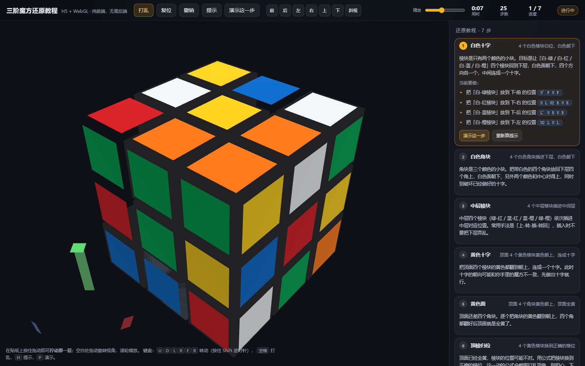

# 🧊 三阶魔方还原教程（H5 + WebGL）

一个**纯前端、零依赖、零后端**的三阶魔方：可自由旋转缩放的 3D 魔方、鼠标直接"拧"层，
以及一套会**跟着你的进度走**的 7 步还原教程。

双击 `rubiks-cube/index.html` 就能用（`file://` 直接跑，不需要服务器、不需要构建、不联网）。



---

## ✨ 功能

| 能力 | 说明 |
| --- | --- |
| 🧊 3D 魔方 | 原生 WebGL 手写渲染：26 个块 + 54 张贴纸，Blinn-Phong 高光，块体间隙即塑料边框 |
| 🖱️ 鼠标拧层 | 在任意贴纸上**按住拖动**即可拧动那一层，拖动方向决定转向，转过 45° 自动吸附到 90° |
| 🔄 视角 | 空白处拖动轨道旋转、滚轮/滑块缩放、右上角 6 个预设视角（前/后/左/右/上/下）+ 斜视 |
| 📐 三维坐标轴 | 画面左下角常驻 X/Y/Z 轴 gizmo（红/绿/蓝），随视角实时旋转，并标注轴名 |
| 📖 7 步教程 | 白色十字 → 白色角块 → 中层棱块 → 黄色十字 → 黄色面 → 顶棱归位 → 顶角归位 |
| 💡 提示 / 演示 | 自动算出当前这一步的公式（**整盘模拟校验过**），点「演示这一步」自动播放动画 |
| 🎯 目标高亮 | 当前要处理的那块在 3D 里发光描边，配合右侧文字说明"把哪个块放到哪" |
| ⏱ 计时 / 步数 | 首次转动开始计时，还原后自动停表并显示「已还原」 |
| ↩️ 撤销 / 打乱 / 复位 | 完整撤销栈；打乱 25 步带动画；复位一键还原 |
| 🧩 六面展开图 | 右侧实时显示展开图（54 格），配合 3D 一起看 |

---

## 🚀 运行

```bash
# 方式一：直接双击（推荐，file:// 就能跑）
start rubiks-cube\index.html

# 方式二：起个静态服务器（也支持）
npm run dev        # http://127.0.0.1:5173/rubiks-cube/index.html
```

**零依赖**：没有 npm 包、没有 CDN、没有后端接口，所有几何与贴纸都是运行时算出来的。

---

## 🎮 操作

| 操作 | 效果 |
| --- | --- |
| 在贴纸上按住拖动 | 拧动那一层（方向跟随拖动） |
| 在空白处拖动 | 旋转视角 |
| 滚轮 / 滑块 | 缩放 |
| `U` `D` `L` `R` `F` `B` | 转动对应面（按住 `Shift` 为逆时针） |
| `空格` | 打乱 |
| `Z` | 撤销 |
| `H` | 重新计算当前步骤的提示 |
| `P` | 演示当前步骤 |
| `1`~`6` | 前 / 后 / 左 / 右 / 上 / 下 视角 |

---

## 🧩 教程是怎么"算"出来的

`src/solver.js` 没有写死一张"人类公式表"，而是把教程拆成 7 个阶段、再拆成若干"小任务"
（把某个块放到某个位置 / 某个朝向），每个小任务这样求解：

1. **单块状态空间**：棱块 / 角块各自只有 24 种（位置 × 朝向）合法姿态，在这个小图上做 BFS；
2. **核心公式反解**：对每个候选公式，反推出"块必须先摆成什么姿态，这个公式才能把它送进目标位"；
3. **找位路径**：在单块状态图上找出能把块摆到该姿态的走法（优先用交换子 `[A,B]` 结构，
   这种结构只影响两个面的交集，天然不会把底层的其它棱块弄乱）；
4. **整盘校验**：把拼出来的序列真正套到整颗魔方上模拟一遍，确认「目标达成」**且**
   「已完成的部分没有被破坏」——不满足就换一条路径 / 换一个公式。

所以界面上给出的每一条公式，都是**被整盘模拟验证过的正确解**，不会教错动作。
后期步骤（顶面朝向、顶棱/顶角归位）采用"标准公式库 + 贪心迭代"：从公式库里挑一个
能让当前阶段进度最大的公式反复执行，直到阶段目标达成。

> 说明：第 1~2 步的提示可以稳定地"一把过"；更后面的步骤受限于"公式库覆盖度"，
> 有时只能保证"把目标块摆到位"、整步收尾需要手动补一下——界面会在这种情况下明确提示。

---

## 📁 代码结构

```
rubiks-cube/
├── index.html          页面骨架 + 全部样式
└── src/
    ├── core.js         魔方核心模型：26 块状态、6 面转动、记号解析、六面取色
    ├── solver.js       7 步教程求解器：阶段判定 + 提示公式（整盘模拟校验）
    ├── gl.js           WebGL 小工具：着色器、缓冲、列主序 4x4 矩阵
    ├── renderer.js     场景渲染：块体、贴纸、高亮描边、坐标轴 gizmo
    ├── camera.js       轨道相机 + 6 个视角预设
    ├── controls.js     鼠标/触摸交互：拧层、轨道、缩放
    ├── main.js         主程序：状态、动画队列、计时、教程联动
    └── ui.js           界面：步骤卡、六面展开图、状态栏、坐标轴标签
```

所有脚本都是**经典 `<script>`**（不是 ES module），因此 `file://` 下不会被 CORS 拦住。

---

## ✅ 自测

```bash
node rubiks-cube/tools/selftest.mjs   # 25 项离线断言（纯 Node，不开浏览器）
node rubiks-cube/tools/verify.mjs     # 35 项无头 Edge 端到端验证 + 截图
```

`selftest.mjs` 覆盖：转动方向（R/U/F/D/L/B 各面的标准含义）、逆转动、置换奇偶性、
经典算法（Sune / T-perm / sexy move）的公认效果、六面取色、阶段判定与提示公式校验。

`verify.mjs` 用 CDP 驱动真实 Edge 打开 `file://` 页面，检查 WebGL 真的画出了东西
（读像素）、**用真实鼠标事件拧动一层**、撤销/打乱/复位、提示公式能被模拟验证、
演示动画、视角预设、缩放、键盘、计时，并输出截图到 `tools/shots/`。

---

## 🧠 记号约定

采用国际标准记号（顺时针均以**面向该面**为准）：

- `U` 上、`D` 下、`F` 前、`B` 后、`R` 右、`L` 左；`'` 表示逆时针，`2` 表示 180°
- 配色：上=黄、下=白、前=绿、后=蓝、右=红、左=橙
- 教程按**白色在下**的经典 beginner method 展开（白色十字 → 白色角块 → 中层 → 黄色面 → 顶面归位）
