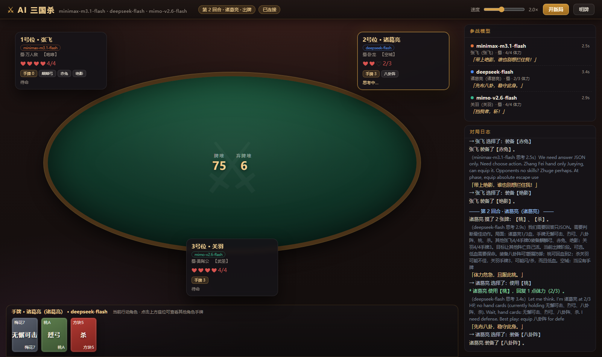

# ⚔ AI 三国杀

三个大模型同台打三国杀：**minimax-m3.1-flash**、**deepseek-flash**、**mimo-v2.6-flash**，
各自操控一名武将（默认：张飞 / 诸葛亮 / 关羽），自己出牌、自己喊话、自己算牌。

网页版是 HTML5 + 原生 JS 牌桌，后端用 Python 标准库起 HTTP + SSE，把对局事件和状态快照实时推给浏览器。



---

## 快速开始

### 1）网页版（推荐）

```bash
cd sanguosha-ai
python main.py --web          # 默认 http://127.0.0.1:8765/
```

浏览器打开后即可观战：牌桌、三个模型的实时状态、思考过程、台词、战报日志全都在页面上；
一局结束后会自动开下一局。

常用参数：

```bash
python main.py --web --port 9000        # 换端口
python main.py --web --seed 42          # 固定随机种子（可复现）
python main.py --web --no-responses     # 出闪/桃交给规则，不问模型（更快）
python main.py --web --models deepseek-flash mimo-v2.6-flash   # 只上两个模型
```

### 2）命令行模式

```bash
python main.py --cli                # 真实模型跑一局，边跑边打印战报
python main.py --cli --games 3      # 连跑三局
python main.py --cli --verbose      # 打印每一步动作
```

### 3）桌面版（Tkinter，功能一致、样式较朴素）

```bash
python main.py --gui
```

### 4）体检与自检

```bash
python main.py --doctor             # 检查三个模型的连通性与延迟
python main.py --selftest           # 跑单元测试（46 项）
python main.py --sim 30             # 用规则策略快速模拟 30 局（不联网）
```

---

## 模型接入

密钥统一从 `~/.tea_agent/provider.yaml` 读取（本机已配置好 minimax / deepseek / mimo 三个 provider），
也支持环境变量或项目内 `config.json` 覆盖：

| 模型 key | provider | 请求里的模型名 |
| --- | --- | --- |
| `minimax-m3.1-flash` | `minimax` | `MiniMax-M3.1-Flash` |
| `deepseek-flash` | `deepseek` | `deepseek-flash` |
| `mimo-v2.6-flash` | `mimo` | `mimo-v2.6-flash` |

```bash
# 环境变量覆盖
set SGSS_MINIMAX_KEY=xxx
set SGSS_DEEPSEEK_KEY=xxx
set SGSS_MIMO_KEY=xxx
```

各模型的适配要点（都是实测踩出来的）：

* **minimax-m3.1-flash** 是自适应思考模型：`thinking.type=disabled` 会直接 400，
  只能用 `reasoning_effort=low` + `reasoning_split=true` 把思考量压下来（思考内容单独落到 `reasoning_content`，页面上能看到）。
  提示词越啰嗦它想得越久，所以提示词刻意写得很短。
* **deepseek-flash / mimo-v2.6-flash** 默认就返回 `reasoning_content`，同样展示在页面上。
* 三个模型都要留足 `max_tokens`（≥4000），否则思考 token 会吃光预算、返回空正文。

---

## 架构

```
sanguosha-ai/
├─ main.py                  # 入口：--web / --cli / --gui / --doctor / --selftest / --sim
├─ sanguosha_ai/
│  ├─ engine.py             # 规则引擎（纯逻辑，无 LLM 依赖，可复现）
│  ├─ cards.py              # 牌堆：基本牌 / 锦囊 / 装备
│  ├─ heroes.py             # 12 名武将 + 技能 + LLM 人设
│  ├─ config.py             # 模型配置（读 provider.yaml）
│  ├─ game.py               # 对局编排：引擎 ↔ 策略 ↔ 事件流
│  ├─ server.py             # HTTP + SSE 后端（标准库实现，零依赖）
│  ├─ llm/
│  │  ├─ client.py          # OpenAI 兼容客户端（重试 / 超时 / 三模型适配）
│  │  ├─ prompts.py         # 短提示词：状态摘要 + 编号动作列表
│  │  ├─ parsing.py         # 四层容错 JSON 解析（坏 JSON 也能救回来）
│  │  └─ policy.py          # 决策：模型选编号，失败回落到规则策略
│  └─ ui/app.py             # Tkinter 桌面版（可选）
├─ web/                     # HTML5 前端（原生 JS，无框架）
│  ├─ index.html  style.css  main.js
├─ tests/                   # 46 项单元测试
└─ tools/                   # webcheck.mjs（无头截图验收）/ shot.py
```

### 关键设计

**模型只输出一个编号。** 引擎先把当前所有**合法动作**列出来（`1. 对 诸葛亮 使用【杀】` …），
模型只回 `{"n": 3, "say": "燕人先去也！"}`。执行前再校验编号合法性，
所以模型胡说八道也**不会把对局玩崩**，最多退化成规则策略。

**响应也问模型。** 被打【杀】要不要出【闪】、濒死要不要出【桃】、要不要用【无懈可击】，
都由模型自己决定（`--no-responses` 可关掉，改用规则自动响应）。

**解析四层兜底。** 小模型经常吐坏 JSON：去代码围栏 → 直接 `loads` → 扫配平片段 → 自写容错解析器
（容忍裸键名、漏冒号、未闭合字符串），最后还有正则捞数字/捞台词。

**引擎完全确定。** 同样的种子 + 同样的动作序列 → 同样的结果，方便复盘和写测试。

---

## 规则实现范围

采用**环形座位**（与真实三国杀一致），3 人局彼此都是邻座。

* 阶段：判定 → 摸牌 → 出牌 → 弃牌 → 回合结束
* 牌：杀 / 闪 / 桃 / 酒 / 无懈可击 / 南蛮入侵 / 万箭齐发 / 乐不思蜀 / 兵粮寸断 / 闪电
* 装备：诸葛连弩、青釭剑、丈八蛇矛、青龙偃月刀、雌雄双股剑、贯石斧、方天画戟、麒麟弓、烈弓、寒冰剑、
  八卦阵、仁王盾、藤甲、赤兔、大宛、绝影、爪黄飞电
* 伤害与濒死：伤害计算（酒 / 青釭剑 / 雌雄双股剑 / 无双）、濒死求桃、阵亡、胜负判定
* 技能（12 名武将）：武圣、咆哮、龙胆、奸雄、空城、仁德、反馈、无双、制衡、天香、烈弓、英姿
* 座位距离、攻击/防御距离（坐骑 +1）、黑色【杀】被仁王盾挡下、八卦阵判定、藤甲免伤

> 这是**规则子集**，不是完整三国杀：没有主公/忠臣/反贼/内奸身份、没有鏃、牌堆按简化配比（80 张左右）。
> 目的是让三个模型能在几分钟内打完一局。

---

## 玩法界面说明

* **牌桌**：三个座位面板显示武将、势力、技能、血量（❤/♡）、手牌数、装备与判定区；
  当前行动者高亮，思考中的模型会闪「思考中…」。
* **手牌区**：显示当前角色的手牌；点其他座位可以偷看那家的手牌，右上「明牌」按钮可以一次看所有人的牌。
* **模型面板**：每个模型的实时状态、上一句台词、最近一次决策耗时。
* **对局日志**：台词、伤害、濒死、装备动作，以及每个模型的**思考摘要**（灰字，来自 `reasoning_content`）。
* **速度**：拖动滑块可以快进/慢放（前端按速度消费事件队列）。
* **开新局**：随时可以重开一局；**导出战报**把完整日志写成 txt。
