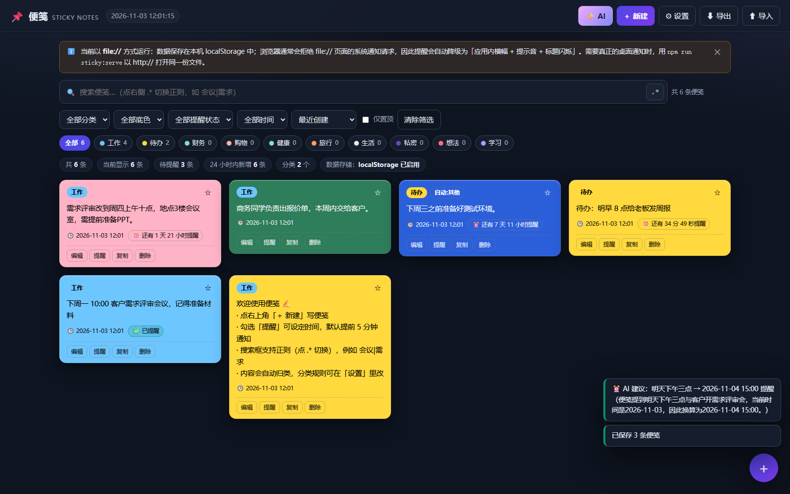
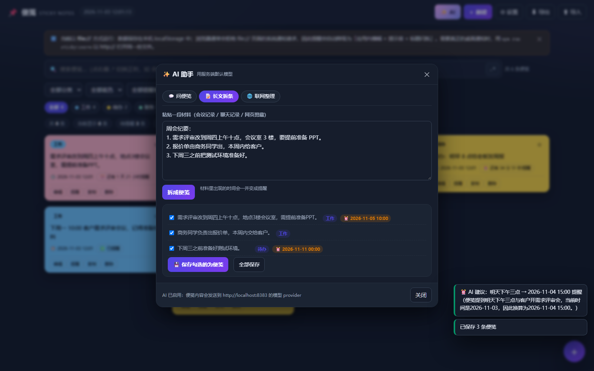

# 📌 便笺 · Sticky Notes

一个**纯前端、纯本地**的便笺应用：双击 `index.html` 就能用，不需要服务器、不联网、不上传任何数据。
可选地接上本机 tea_a2（`http://localhost:8383`）获得 **AI 增强**：AI 归类、AI 抽时间、问便笺、长文拆条、联网整理。



---

## 快速开始

| 方式 | 操作 | 说明 |
| --- | --- | --- |
| **直接双击** | 打开 `sticky-notes/index.html` | `file://` 协议，零依赖零配置 |
| **单文件版** | 打开 `sticky-notes/sticky-notes.html` | 133 KB 单文件，拷到哪都能用（由 `npm run sticky:build` 生成） |
| **本地 HTTP** | `npm run sticky:serve` → <http://127.0.0.1:5177/> | 唯一能拿到**真正桌面通知**的运行方式（见下文「提醒与通知」） |

数据保存在浏览器本机 `localStorage`（键名 `sticky-notes/v1`），刷新/关机都不丢；换浏览器或清缓存会丢，重要内容请用「导出 JSON」备份。

---

## 三个核心需求怎么实现的

### 1️⃣ 彩色底色 + 高对比度文字

- 内置 **12 种便笺底色**（柠檬黄 / 蜜桃橙 / 玫瑰红 / 樱花粉 / 薄荷绿 / 森林绿 / 天空蓝 / 靛青蓝 / 薰衣草 / 紫罗兰 / 石墨灰 / 米白），也可以用取色器自选任意底色。
- 文字色默认 **自动挑选对比度最高**的候选（近黑 / 白 / 纯黑），编辑器里实时显示 **WCAG 对比度**与等级徽章：

  | 对比度 | 等级 | 含义 |
  | --- | --- | --- |
  | ≥ 7:1 | `AAA` | 最佳 |
  | ≥ 4.5:1 | `AA` | 正文可读（所有内置底色均达标） |
  | ≥ 3:1 | `AA-Large` | 仅大字可读 |
  | < 3:1 | `不合格` | 会提示改用自动配色 |

- 也可以手动指定文字色；一旦手动指定，对比度不足会当场警告。
- 分类标签同样按底色自动取高对比文字色，深浅色都清晰。

> 实现见 `src/core.js` 的 `contrastRatio()` / `bestTextColor()` / `contrastGrade()`（按 WCAG 2.1 相对亮度公式计算）。

### 2️⃣ 自动记录日期时间 + 提前 5 分钟提醒

- 新建便笺时 **自动写入创建时间**（毫秒时间戳），卡片底部显示 `2026-11-03 07:51`，鼠标悬停可看到精确到秒。
- 勾选「开启提醒」并指定时间后：
  - 触发时刻 = **指定时间 − 提前量（默认 5 分钟）**，提前量可在设置里改（0–120 分钟）；
  - 卡片上实时显示**倒计时**（`⏰ 还有 34 分 59 秒提醒`）；
  - 到点后状态变为 `✅ 已提醒`；超时太久没开会标记 `⏰ 已过期`。
- 勾选提醒时会 **申请浏览器通知权限**（`Notification.requestPermission()`），设置面板里也有「申请浏览器通知权限 / 发送测试通知」按钮。

**关于 file:// 下的通知限制**（实测行为）：

| 环境 | 桌面通知 | 兜底方案 |
| --- | --- | --- |
| `file://`（双击打开） | Chrome/Edge **直接拒绝**权限申请 | 自动降级为「应用内横幅 + 提示音 + 标题闪烁 🔔」，不丢提醒 |
| `http://`（`npm run sticky:serve`） | 正常授权并弹出系统通知 | — |

也就是说：**双击打开也一定会提醒你**，只是形式是应用内横幅；要桌面弹窗就改用 http 方式打开同一份文件。

其他兜底细节：

- 提醒用 `setTimeout` 精确定时 + 30 秒轮询兜底（后台标签页被节流时也不会漏）；
- 页面关闭期间错过的提醒，重新打开会在 1 小时宽限期内补发，超时则标记为「已过期」；
- 提醒状态、已提醒时间都会持久化，刷新后不会重复响。

### 3️⃣ 自动归类 + 正则查询

**自动归类**：按内容命中规则，规则在设置面板里可视化编辑（分类名 / 正则 / 优先级 / 颜色）。

内置 10 条规则：私密、待办、财务、工作、学习、健康、购物、旅行、想法、生活。

判定规则：

1. `私密` 是 **sticky 规则**，命中即锁定分类（避免「密码」被别的词稀释）；
2. 其余规则按 **命中关键词数量** 多者胜（如「客户需求评审会议，记得准备材料」→ 命中 `客户/需求/评审/会议` 4 次 > `记得` 1 次 → 归为 **工作**）；
3. 数量相同再比 **优先级**（大者优先）；
4. 每条便笺同时记录 `autoCategory`（自动识别结果）与 `category`（最终分类）。手动改过分类的便笺带 `manual` 标记，**重新归类时不会被覆盖**。

编辑器里会实时提示：`按内容自动识别为「工作」（命中「客户、需求、评审」）`。

**正则查询**：

- 搜索框右侧 `.*` 按钮切换正则模式（快捷键 `R`），也支持 `/` 直接聚焦搜索、`Ctrl+F` 搜索；
- 正则模式下用 `会议|需求`、`^待办`、`\d{4}-\d{2}-\d{2}` 这类表达式检索，命中处在便笺正文里**高亮**；
- **非法正则不会让页面崩**：搜索框变红并提示 `正则无效：Invalid regular expression: …`，同时继续展示全部便笺；
- 普通模式按子串匹配（忽略大小写，特殊字符会被转义，不会误当正则）；
- 搜索结果实时显示「命中 N 条便笺 / M 处匹配」。

另外还有：分类 / 底色 / 提醒状态 / 创建时间四类筛选，5 种排序，分类 chip 快速筛选（带条数），置顶、复制、删除，JSON 导入导出，深浅色自适应主题。

---

## ✨ AI 增强（接本机 tea_a2）

便笺可以调用本机 tea_a2 的 `POST /api/llm/chat` 做增强。**默认关闭**——关闭时应用完全离线、一个网络请求都不发；打开后才会有内容离开本机。

### 打开方式

1. 启动本机 tea_a2（默认 `http://localhost:8383`，`GET /api/health` 能探活）；
2. 便笺「⚙ 设置 → AI 增强」里勾选「启用 AI 增强」，地址填 `http://localhost:8383`，点「测试连接」确认；
3. 顶栏出现「✨ AI」按钮，编辑器里多出「✨ AI 归类」「⏰ AI 建议提醒时间」。

> **file:// 直接打开也能用**：tea_a2 的 CORS 响应头是 `Access-Control-Allow-Origin: *`，
> 所以 `file://` 页面可以直接 `fetch` 本机接口，不需要额外起服务器。



### 五个 AI 能力

| 入口 | 干什么 | 实测效果 |
| --- | --- | --- |
| **✨ AI 归类**（编辑器内） | 按内容挑一个分类，附带命中关键词与理由 | 「明天下午三点和客户开需求评审会，顺便确认报价」→ `工作`，命中「客户、需求评审会、报价」 |
| **⏰ AI 建议提醒时间**（编辑器内） | 从便笺里抽出时间，换算成绝对时间并填进提醒框 | 「明天下午三点…」→ `2026-11-04T15:00`，自动勾选提醒 |
| **💬 问便笺**（AI 面板） | 把**当前筛选后**的便笺作为上下文提问，答案用 `[编号]` 引用来源，点引用可跳到那条便笺 | 「我这周有哪些会议要参加？」→ 答案 + 可点击来源 |
| **📝 长文拆条** | 粘贴会议记录/聊天记录/网页剪藏 → 拆成若干条便笺；材料里的时间会**顺带变成提醒**；可勾选后批量保存 | 3 行周会纪要 → 4 条要点，其中 2 条带 `⏰` 提醒时间 |
| **🌐 联网整理** | 走 tea_a2 的 `web_tools`（服务端代模型调搜索端点），把搜索结果整理成便笺 | 会联网、**按次计费**，默认不跑 |

### 思考强度：为什么要「自动」

不同模型支持的 `reasoning_effort` 档位并不一致，实测（tea_a2 0.18.4 / deepseek-flash）：

| 档位 | 表现 |
| --- | --- |
| 不传 / `low` / `medium` | **思考把输出预算吃光**：`finish_reason=length`、正文为空（4000 token 全是 reasoning，跑 8 秒还拿不到内容） |
| `none` | ✅ 1.8 秒返回正文，`reasoning` 为空 |
| `off` | ❌ 上游 `422 unknown variant 'off'` |

但 `none` 不是所有模型都认（MiniMax 会以 `requires adaptive thinking` 拒绝，mimo 不认 `minimal`）。
所以应用内置**阶梯降级**：`none → minimal → low → 不传该字段`，失败自动换下一档，并记住每个
provider/model 实际能用哪一档（`ai.js` 的 `effortCache`）。设置里可以固定成「不思考」或「允许思考」。

### 隐私

启用后，**便笺内容会发送给你配置的模型 provider**（默认本机 tea_a2 → deepseek-flash，内容会进入云端模型）。
关掉开关就完全离线。设置面板里对此有明确提示。

---

## 目录结构

```
sticky-notes/
├─ index.html            # 入口（双击即可运行）
├─ sticky-notes.html     # 单文件版（npm run sticky:build 生成）
├─ src/
│  ├─ core.js            # 纯逻辑层：配色对比度 / 自动分类 / 正则检索 / 提醒计算 / 过滤排序
│  ├─ ai.js              # AI 层：提示词构造 / 模型输出解析 / 思考强度阶梯降级 / 接口调用
│  ├─ ai-ui.js           # AI 交互层：AI 面板、编辑器里的 AI 按钮
│  ├─ app.js             # 交互层：DOM 渲染 / 增删改查 / 提醒调度 / 通知申请 / 设置面板
│  └─ styles.css         # 样式：便笺卡片、高对比徽章、弹窗、AI 面板、响应式
└─ tools/
   ├─ selftest.mjs       # 81 项离线断言（Node 直跑，无需浏览器、无需接口）
   ├─ verify.mjs         # 无头 Edge 端到端验证（44 项 + 截图，含真实 AI 调用）
   ├─ ai-check.mjs       # AI 接口联调（17 项，打真实 tea_a2）
   ├─ build-single.mjs   # 打包单文件版
   ├─ serve.mjs          # 本地 HTTP 服务器（拿桌面通知用）
   └─ shots/             # 验证过程产出的截图
```

`src/core.js` 与 `src/ai.js` 都不依赖任何 DOM，浏览器和 Node 都能加载，所以核心算法可以离线断言。

---

## 命令

```bash
node sticky-notes/tools/selftest.mjs            # 81 项离线断言（颜色/分类/正则/提醒/过滤/AI 提示词与解析）
node sticky-notes/tools/verify.mjs              # 无头 Edge 端到端验证 + 截图（file:// 真实场景，含 AI）
node sticky-notes/tools/verify.mjs sticky-notes.html   # 同上，验证单文件版
node sticky-notes/tools/ai-check.mjs            # AI 接口联调（打真实 tea_a2；接口没起会自动跳过）
node sticky-notes/tools/ai-check.mjs --search   # 额外跑一次联网整理（会联网、按次计费）
node sticky-notes/tools/build-single.mjs        # 生成 sticky-notes.html
node sticky-notes/tools/serve.mjs              # http://127.0.0.1:5177/
```

无头验证依赖本机 Edge/Chromium，默认路径 `C:\Program Files (x86)\Microsoft\Edge\Application\msedge.exe`，可用环境变量覆盖：

```bash
EDGE_PATH=/path/to/chrome node sticky-notes/tools/verify.mjs
```

`verify.mjs` 用 Chrome DevTools Protocol 驱动真实浏览器，覆盖：file:// 启动、localStorage 可用、新建便笺 → 自动归类 → 选底色 → 对比度达标 → 提前 5 分钟触发提醒 → 应用内兜底横幅 → 普通/正则/非法正则检索 → 刷新后持久化 → **AI 归类 / AI 时间抽取 / AI 问答 / AI 拆条并批量保存** → 全程零 JS 异常。

`ai-check.mjs` 则从 Node 侧直接打接口：连通性、分类、时间抽取、长文拆条、问答引用。

---

## 快捷键

| 快捷键 | 作用 |
| --- | --- |
| `Ctrl/⌘ + N` | 新建便笺 |
| `Ctrl/⌘ + F` 或 `/` | 聚焦搜索框 |
| `R` | 切换正则模式 |
| `Esc` | 关闭弹窗 |

---

## 隐私

- 默认**完全离线运行**，不发送任何网络请求；
- 数据只在本机浏览器 `localStorage`；
- 启用 AI 后，便笺内容会发送给所配置的模型 provider（设置面板有明确提示）；
- 「私密」分类会对疑似密码/密钥的内容给出警告，提醒不要把凭据写进便笺。

## License

MIT
